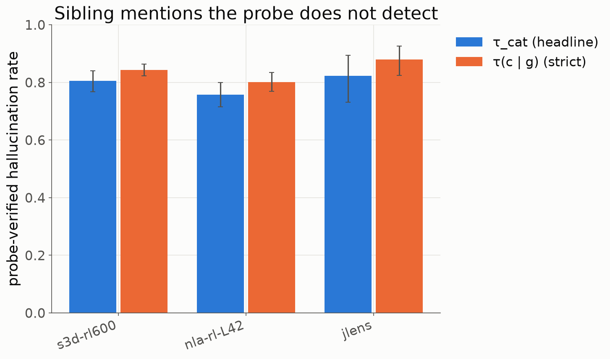
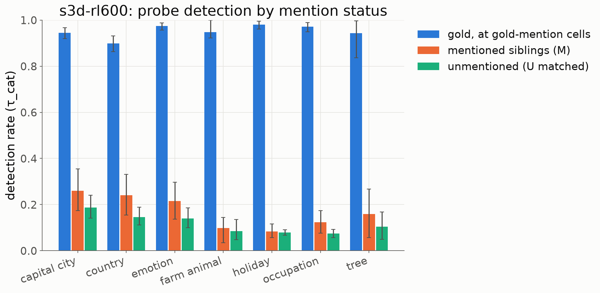

# Results 0003: are same-category sibling mentions hallucinations? (concept-probe check)

Plan `plans/0003-sibling-concept-probes.md` (rev 11). Issue #5, PR #6. Final run 2026-10-12:
- probes: run `sibling-v3`, both recipes;
- judge: `claimmap-v2.7` (plan 0002 rev 17), `claude-opus-5-5`, effort low.

The full machine report is `outputs/sibling/score/report.md` (`hbench sibling report`); the
cross-lens overlap is `outputs/sibling/overlap/overlap.md` (`scripts/sibling_probe/arm_overlap.py`).

## Question

When a lens names several instances of one category where the context implies only one (the
user is Korean and the readout says "Korea … China"; the user is embarrassed and the readout
says "angry"), are the extra **siblings** hallucinations, or does the model actually represent
them? We build one probe per concept and test whether a sibling's probe fires where a lens
names it.

## Answer in one paragraph

**Mostly hallucinations, with a small real signal.** With probes that now detect the gold
concept 96% of the time where a lens names it, **81% of the s3d O-lens's sibling mentions are
not backed by a probe-detectable representation** (NLA 76%, J-lens 82%). The miss rate on
certain-true mentions is only 4%, so this is not probe weakness. Still, a sibling's probe scores
higher where the lens names it: the pre-registered verdict is *supported* for the O-lens and for
NLA under both probe recipes. Siblings named by several lenses are more often real: probe
detection is 5% when no lens names the sibling, 9% for one lens, 17% for two and 22% for all
three, and s3d + NLA without J-lens alone gives 17%. One caveat flips with the recipe: the J-lens
positive control passes with raw DiffMean probes but fails with the better whitened probes.

## Making the probes good (plan rev 11)

The first probes (raw DiffMean on per-text means) were weak: held-out AUROC ≥ 0.85 for only 34%
of (concept, layer) probes, and they caught the gold only 72% of the time. A recipe sweep scored
only probe texts and gold-item eval cells, never lens mentions or the judge. It picked the
**whitened DiffMean (shrinkage LDA)**: the difference of class means, whitened by the shrunk
within-concept covariance, with λ chosen by inner CV on the training folds. It even matched a
supervised logistic-regression ceiling.

| probe recipe | held-out AUROC median | probes ≥ 0.85 | eval-site transfer | gold detected where named | wsbench human-written items (transfer) |
|---|---|---|---|---|---|
| raw DiffMean (V0, first run) | 0.80 | 34% | 0.85 | 72% | 0.69 [0.66, 0.76] |
| **whitened DiffMean (V2)** | **0.94** | **79%** (401/510 pass both gates) | **0.96** | **96%** | **0.89 [0.86, 0.94]** |
| logistic regression (reference) | 0.92 | 72% | 0.95 | n/a | n/a |

- **By category:** country, capital city, emotion, holiday and occupation pass the 0.85 gate
  almost everywhere. Farm animal (7/55 probes) and tree (20/80) still fail and are reported as
  "probes too weak to adjudicate".
- **Calibration:** false positives at the 95th-percentile threshold run at 7.6% on other-gold
  eval cells and 8.2% on neutral texts (target 5%). The threshold is deliberately not
  recalibrated on eval cells.
- **Disclosure:** the sweep was run after the first results were visible, and the better
  recipe detects more by construction. So both recipes are reported in every headline cell, and
  "recipe-sensitive" is flagged where they disagree. The flag fires only for the J-lens control
  (below).

## Headline (whitened probes, judge v2.7)

The probe-verified hallucination rate is the share of sibling mentions (judged not correct)
whose probe does not fire at τ_cat. The strict threshold τ(c | g) is the sibling probe's 95th
percentile on ordinary contexts of the item's gold. Only gate-passing probes count. CIs are 95%,
item-clustered.

| lens | M pairs | **halluc rate** | strict τ(c\|g) | gold-miss floor | det(M) | det(unmentioned, matched) | normalised 1 − det(M)/ceiling | raw-DiffMean rate |
|---|---|---|---|---|---|---|---|---|
| **s3d O-lens** | 2,641 | **80.5%** [76.7, 84.1] | 84.3% | 4.4% | 19.5% | 12.7% | 79.6% | 86.1% |
| **NLA-RL L42** | 662 | **75.7%** [71.6, 80.0] | 80.1% | 5.3% | 24.3% | 15.6% | 74.4% | 81.1% |
| **J-lens** | 158 | **82.3%** [73.1, 89.4] | 88.0% | 0.7% | 17.7% | 19.0% | 82.2% | 75.9% |

### Pre-registered verdict

- **β₁:** at the same item, layer and concept, the probe's z where the lens names the sibling
  vs where it does not (offset fixed effects).
- **β₂:** at the same activation, named siblings vs unnamed siblings.

| lens | probe | β₁ (z) | β₂ (z) | verdict |
|---|---|---|---|---|
| s3d O-lens | whitened | 0.14 [0.10, 0.19] | 0.47 [0.36, 0.58] | **supported** |
| s3d O-lens | raw | 0.26 [0.20, 0.32] | 0.34 [0.24, 0.45] | supported |
| NLA-RL L42 | whitened | 0.23 [0.14, 0.34] | 0.70 [0.55, 0.86] | **supported** |
| NLA-RL L42 | raw | 0.34 [0.25, 0.43] | 0.62 [0.50, 0.75] | supported |
| J-lens (positive control) | whitened | 0.14 [−0.03, 0.33] | 0.64 [0.36, 0.92] | **control fails** (β₁ CI includes 0) |
| J-lens (positive control) | raw | 0.59 [0.42, 0.79] | 1.24 [1.05, 1.44] | control passes |

The pre-registered rule makes the control decisive only for a *not supported* verdict, so
*supported* stands. The control failure is still a substantive caveat. A plausible reading:
raw DiffMean shares some output-token direction with the J-lens readout, and whitening strips
it (median cosine of the probe with its concept's unembedding falls from 0.094 to 0.061). That
would leave J-lens's own extra signal near zero (its excess over matched cells, −0.015, CI
spans 0).

How much of a mention is "real": the excess ratio (det(M) − floor) / (ceiling − floor) is
0.08 [0.05, 0.11] for s3d and 0.11 [0.07, 0.15] for NLA. The pre-registered "strongly
supported" bar is > 0.5.

### By category (s3d O-lens, whitened)

| category | halluc rate | strict τ(c\|g) | gold ceiling | status |
|---|---|---|---|---|
| capital_city | **74%** [64, 83] | 84% | 95% | adjudicable |
| country | 76% [67, 85] | 74% | 90% | adjudicable |
| emotion | 78% [70, 86] | 86% | 98% | adjudicable |
| occupation | 88% [83, 92] | 88% | 97% | adjudicable |
| holiday | 92% [88, 94] | 90% | 98% | adjudicable |
| farm_animal | (90%) | (93%) | 95% | probes too weak |
| tree | (84%) | (83%) | 94% | probes too weak |

## Do the three lenses name the same siblings?

**Partly, and their agreement tracks real representation.**

| at the same (item, position), NLA L42 vs s3d / J-lens L44 | P(B \| A) | lift | within-category null lift | same-gold null lift |
|---|---|---|---|---|
| s3d → NLA | 0.18 | 10.8 | 2.5 | 8.5 |
| s3d → J-lens | 0.04 | 9.9 | 1.5 | 6.6 |
| NLA → J-lens | 0.04 | 11.8 | 2.1 | 9.3 |

- **Same-activation agreement:** lenses co-name the same sibling about 10× more often than
  chance, and above both nulls. Much of that comes from the gold's usual associates; the
  same-gold null alone gives about 7–9×, and it is near-degenerate (2 items per gold).
- **Item level, pooled over layers:** 1,207 (item, sibling) pairs are named by at least one
  lens and 90 by all three; s3d names the most.

**Agreement vs probe support** (whitened probe at L44, per (item, sibling), over all candidate
siblings, not gate-filtered; concept fixed effects in the report; CIs from 1,000 item-bootstrap
draws):

| lenses naming the sibling | units | probe detection | mean z(c\|g) |
|---|---|---|---|
| none | 1,928 | 5.0% | −0.10 |
| one | 569 | 8.9% | 0.11 |
| two | 238 | 16.8% | 0.23 |
| all three | 57 | 21.8% | 0.35 |
| s3d + NLA, not J-lens | 204 | 17.4% | 0.25 |

With concept fixed effects, detection rises +6.7, +15.1 and +22.3 points over "none" for one,
two and three lenses, all CIs above 0. The s3d + NLA stratum excludes J-lens, so this is not
just the linear readout agreeing with a linear probe. Even a sibling named by all three lenses
is detected only about 1 time in 5.

## Most frequent sibling pairs (s3d, whitened, gate-passing)

| gold → sibling | named n | items | named: det / z | not named: det / z |
|---|---|---|---|---|
| resentful → angry | 43 | 2 | 0.77 / 0.52 | 0.62 / 0.38 |
| fisherman → musician | 43 | 5 | 0.05 / 0.16 | 0.07 / −0.09 |
| Osaka → Tokyo | 32 | 2 | 0.71 / 0.69 | 0.48 / 0.35 |
| Ireland → UK | 28 | 2 | 0.59 / 1.16 | 0.25 / −0.16 |
| jealous → angry | 27 | 2 | 0.00 / 0.30 | 0.01 / 0.12 |
| Osaka → Kyoto | 26 | 2 | 0.71 / 0.71 | 0.38 / −0.13 |
| locksmith → musician | 26 | 5 | 0.00 / 0.28 | 0.03 / −0.25 |
| artist → musician | 25 | 2 | 0.45 / 0.92 | 0.28 / 0.50 |
| fisherman → writer | 25 | 5 | 0.01 / 0.51 | 0.01 / 0.31 |
| New York → Boston | 23 | 2 | 0.35 / 0.45 | 0.42 / 0.59 |
| hopeful → relieved | 23 | 2 | 0.61 / 1.19 | 0.54 / 1.09 |

(det = detection at τ_cat; z = z(c | g); every pair comes from 2–5 items.)

- **Overlap with the gold everywhere:** some close siblings are detected whether named or not
  (resentful → angry, hopeful → relieved).
- **Lower where named:** a few pairs score slightly lower where named (New York → Boston;
  Tokyo ↔ Kyoto in the top 25).
- **Rise where named:** Ireland → UK and Osaka → Kyoto (detection about 0.3 higher where named).
- **No support either way:** occupation swaps (fisherman → musician / writer) and
  jealous → angry are almost never detected.

## Caveats

- **Judge version.** The judge changed twice during this work (v2.5 → v2.7). v2.7 relabels
  incorrect claims that cannot be backed by a verbatim contradiction quote as `unverifiable`.
  Those stay in M (every not-correct claim verdict counts). Headline rates under v2.5 vs v2.7
  (both with whitened probes): s3d 80.7% vs 80.5%, NLA 76.0% vs 75.7%, J-lens 77.6% vs 82.3%
  (the J-lens control passed under v2.5 and fails under v2.7).
- **Gates.** The validity gate is back at the pre-registered 0.85 for the whitened probe; 25% of
  s3d M mentions fall on failing probes, almost all farm_animal / tree. The raw-DiffMean columns
  use the rev-10 gate (0.70) so they reproduce the first run.
- **Coverage.** Rates cover the 11–16 inventory concepts per category
  (`data/sibling_probe/concepts.json`).
- **Scope.** Many NLA sibling mentions sit inside imagined prompts. On the `scope = user` slice,
  s3d is 76%.
- **Failed cells.** After 4 attempts, 77 judged cells failed the claim map and 6 J-lens
  summaries failed (0.8% in total). All are excluded.
- **Setup.** User-modelling prompts with an implied attribute (204 items, 7 categories), read
  from the request sentence through the template tail at L28/36/44/52 (NLA L42); Qwen3.6-27B.

## Pilot and further settings

- **Pilot:** 40 hand-written prompts showed sibling mentions in 8/8 items of each of the 5 new
  categories (country and occupation were checked on the wsbench readouts instead)
  (e.g. Berlin → "central London"; maple syrup → "likely a birch or oak"; goats → "cows on the
  roof").
- **Next categories:** languages, cuisines, sports teams, instruments, dog breeds, car brands,
  religions, historical figures (Picasso / da Vinci).
- **Next experiment:** steer or ablate along a sibling's direction at mention cells and see
  whether the lens mention moves. That is the causal test the probes cannot give.

## Cost

| item | cost |
|---|---|
| Judge v2.5 run (`logs/sibjudge_2026-10-11_0737.log`) | $356 |
| Judge v2.7 re-run (`logs/sibjudge27_2026-10-12_0107.log`) | $375 |
| Generation | $10 |
| Modal (captures; readouts; 3 probe jobs; recipe sweep; Qwen generation) | about $50 |
| **Total** | **about $790** |
