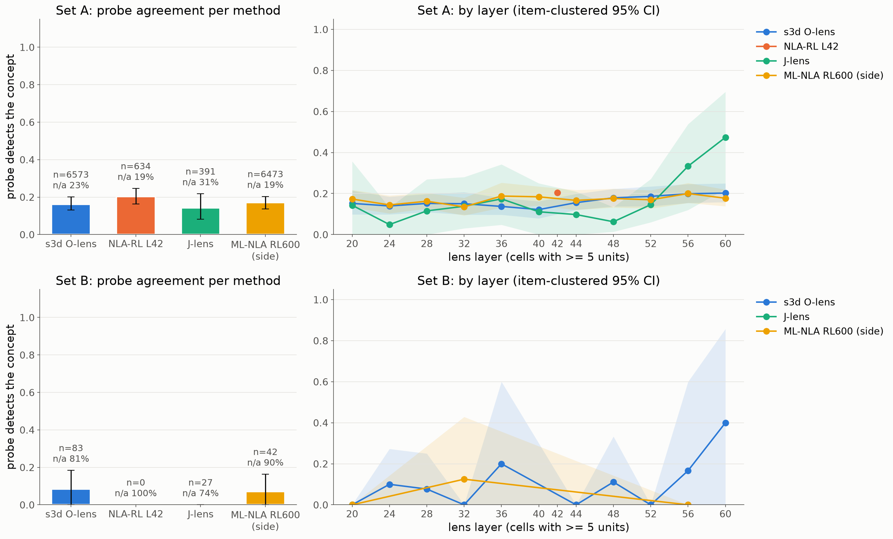
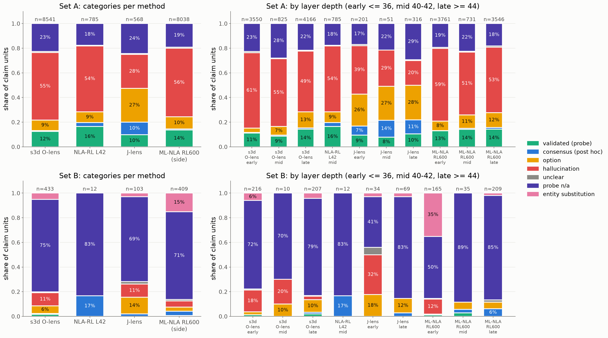

# Results 0004: sibling claims at 11 layers, probe validation, post-probe verdicts

Plan `plans/0004-sibling-verdict-judge-11layer.md` (rev 4). PR #6. Run 2026-10-12.

- **Judges:** claim map `claimmap-v2.7` to find the claims; verdict judge `sibverdict-v2`, after the
  plan's one dev revision.
- **Probes:** whitened DiffMean (plan 0003 rev 11) at all 11 layers.
- **Full tables:** `outputs/sibling/verdict/report.md`.

**Viewer (Agam style):** https://safety-sahan-2-camila-blank--sibling-viewer-web.modal.run. It is
link-key gated; the key is in `/workspace/.sibling_viewer_key`, so open `<url>/?key=<key>` once.
For every question it shows:
- the prompt;
- the readouts of each method at every layer;
- each sibling claim, with its category badge, probe result (z, detected), judge form and quote,
  and the rule label.

Filters cover set, method, layer and category. It includes a filter for the 30 claims waiting for
Camila's labels.

## What was run

- **Set A:** the 204 user-modelling items. Read sites run from the request sentence to the
  template tail, at layers 20, 24, …, 60 for the s3d O-lens, J-lens and ML-NLA RL600 (side method),
  plus NLA-RL L42. That is 43,395 cells per 11-layer method.
- **Set B:** WorkspaceBench `basic_readout`, 35 entity items plus categorical implicit items
  (e.g. Muhammad Ali), read at the final token.
- **Claim units:** sibling / substitution claims found by the claim map, one unit per (method,
  item, layer, position, concept). 18,889 in total.
- **Categories:** each unit gets one category, in this order of precedence:
  1. **validated**: the probe detects the concept;
  2. **consensus (post hoc)**: s3d and J-lens claim it within one grid step and NLA-RL L42 at the
     same item and position;
  3. otherwise the verdict judge decides from the claim's **form**: assertion → **hallucination**,
     alternatives / continuation → **option**, else **unclear**;
  4. separately: **probe n/a** (the probe fails a gate, or the concept is unvalidated) and
     **entity substitution** (a different named entity, e.g. ML-NLA reading Ali as Usain Bolt).

## Figure 1: how often the probes agree, per method

| set A | probe agrees (validated / units with a probe verdict) | probe n/a |
|---|---|---|
| s3d O-lens | 0.16 [0.13, 0.20] (n = 6,573) | 23% |
| NLA-RL L42 | 0.20 [0.16, 0.25] (n = 634) | 19% |
| J-lens | 0.14 [0.08, 0.22] (n = 391) | 31% |
| ML-NLA RL600 (side) | 0.17 [0.14, 0.20] (n = 6,473) | 19% |

- **By method:** the probes confirm about 1 in 6 sibling claims, with no meaningful difference
  between methods.
- **By layer:** agreement is flat across layers (0.12–0.20). The exception is J-lens at L56–60,
  which rises to 0.33–0.47 on few units.
- **Set B:** probes cover only 10–26% of claims, mostly because 31 of 34 basic_readout categories
  have a single gold, so no probe can be validated. Agreement there is 0–8%. Set B is mainly
  about form and layer.

## Figure 2: how the sibling / substitution claims split

Set A, share of all claim units (denominator = all units, sibverdict-v2):

| method | validated | consensus | option | hallucination | unclear | probe n/a | hallucination rate (all units) |
|---|---|---|---|---|---|---|---|
| s3d O-lens | 12% | 1% | 9% | 55% | 1% | 23% | 0.55 [0.49, 0.60] |
| NLA-RL L42 | 16% | 3% | 9% | 54% | 1% | 18% | 0.54 [0.48, 0.59] |
| J-lens | 10% | 10% | 27% | 28% | 1% | 24% | 0.28 [0.21, 0.34] |
| ML-NLA RL600 (side) | 14% | 1% | 10% | 56% | 1% | 19% | 0.56 [0.51, 0.60] |

## Does Camila's rule of thumb hold?

The rule: probe not matched + early layer → hallucination; late layer → option.

- **Weakly, not as a rule.**
  - With the layer hidden from the verdict judge, the judge's form label agrees with the rule
    label only 51% of the time at the default cut. The sweep: cut 32 → 0.33, 36 → 0.43,
    40 → 0.47, 44 → 0.55.
  - The visible and blind judge runs agree 93%, so the layer hint barely moves the judge.
- **The depth trend exists but is small.**
  - The s3d O-lens hallucination share falls from 61% (early) to 49% (late) and its option
    share rises from 4% to 13%.
  - J-lens moves more: hallucination 39% → 20%, option 26% → 28%.
  - Late-layer claims are still mostly assertions for s3d, NLA and ML-NLA.
- **Muhammad Ali** (s3d) fits the rule: L20–32 assert swimming / track / tennis / cricket /
  figure skating ("The sport he practices is **Cricket**"), and L52–56 offer alternatives
  ("Boxing or football"). Across the bank this pattern is the exception.

## Consensus (post hoc)

- **Size:** 30 three-method triples, giving 228 consensus units (e.g. A s3d 82, J-lens 73,
  NLA-RL 28).
- **Probe and form checks:** the probe rejects 93 of them, and 121 are phrased as assertions
  ("hallucinated consensus").
- **Layer:** 51 are early-layer.
- **ML-NLA variant:** using ML-NLA instead of NLA-RL L42 gives more units (s3d 126, J-lens 105,
  ML-NLA 81).

Consensus is a small, post hoc slice. About half of it would be hallucinations by form, so
agreement among methods is weak evidence on its own.

## Judge calibration and two definitional choices for Camila

| | v1 (first prompt) | v2 (after the dev revision) |
|---|---|---|
| agreement with Fable's 40 dev labels (option / hallucination) | 32/40 | 37/40 |
| accuracy vs the blind gold (100, subagent) | 0.83 [0.74, 0.89] | 0.83 [0.74, 0.89] |
| main gold disagreement | 14 gold assertions called option | 11 gold options called hallucination |
| set A s3d option / hallucination units | 4,607 / 784 | 732 / 4,672 |
| set A ML-NLA option / hallucination | 1,442 / 3,776 | 788 / 4,478 |

- **The gold target is missed.** The 85% gold target is missed in both versions. Following the
  plan, the categories above are **"judge (below target)"** and the rule labels are shown next to
  them in the viewer.
- **v2 overcorrected on the gold set.** 9 of its 11 errors are **hedged single guesses**
  ("possibly in baseball", "most likely apples", "possibly the Beatles"). The blind gold labeller
  was given the v1 definitions, which count hedged single candidates as options. v2 counts them
  as assertions.
- **v2 also treats separate readout samples separately.** When different samples name different
  answers, v2 labels each sample as its own assertion, which moves most s3d units (about 4 bullets
  per cell) from option to hallucination.

**Camila decides:**
1. Is a hedged single guess ("possibly baseball") an option or a hallucination?
2. When separate readout samples each name a different sibling, is that a set of options or one
   assertion per sample?

These two choices move the option / hallucination split far more than anything else in this
analysis. The probe results (Figure 1) and the validated and consensus counts do not depend on
them. Her 30 labels (`data/sibling_probe/verdict_human_todo.jsonl`, 6 Ali anchors) will also
settle which version matches her intent.

## Caveats

- **The category split is definition-sensitive** (see above). Probe agreement is the robust
  number.
- **Probe n/a** is about 20–30% of set-A units (validity-gate failures, mostly farm_animal / tree)
  and most set-B units. It is shown as its own bar, never dropped.
- **Hardware:** the ML-NLA reads ran on H200s (the reader hard-codes them), about 53 GPU-hours.
  Camila's "8×B300 always" rule was not applied to the sharded readout jobs (open question).
- **Failed calls:** about 1–2% of claim-map cells failed after retries and are excluded. 80
  verdict-judge refusals (hacker-occupation units) fell back to Sonnet 5.5.

## Cost

| item | cost |
|---|---|
| Set-A claim map (11 layers, 4 methods) | $1,091 |
| Set-B claim map | $81 |
| Verdict judge v1 + v2 (incl. blind runs) | $242 |
| Generation / normalisation | $8 |
| Modal (11-layer captures, ML-NLA about 53 H200-h, s3d / J-lens, probes) | about $250–350, estimated |
| **Plan 0004 total** | **about $1.7k** |
