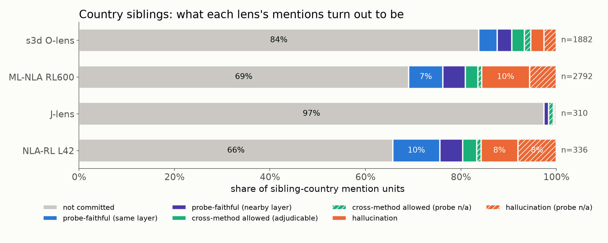
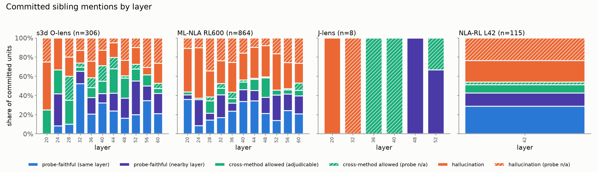
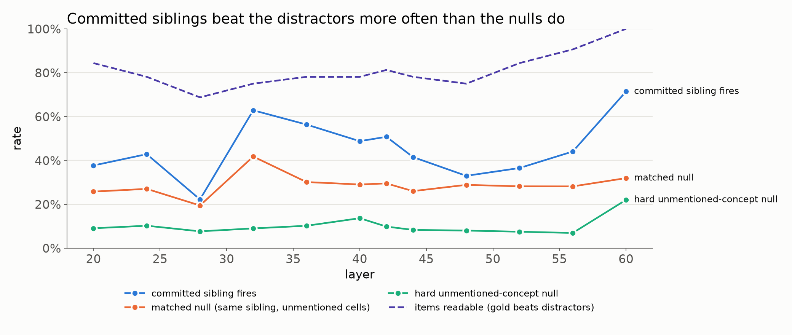

# Results 0006: user-modelling sibling ladder v2, country

Plan `plans/0006-user-modelling-country-ladder.md` (rev 8). Run 2026-10-12/13.
- **Judge:** `umcommit-v1.1` (`claude-opus-5-5`, effort low).
- **Probes:** run `um-country-v2`. The fire rule uses type (a) whitened DiffMean; the both-types
  rule is a sensitivity row (plan rev 8).
- **Machine outputs:** `outputs/sibling/um/label/{summary.json,units_labeled.jsonl,matched_null.jsonl}`.
- **Figures:** `plots/sibling_probe/um_country_*.png`.

## The procedure, as run

1. **Find every non-gold country** in every readout sample of the 32 country items:
   - lenses: s3d O-lens, ML-NLA RL600 and J-lens at L20–60, plus NLA-RL at L42;
   - every read position from the request sentence to the template tail;
   - lexicon: plan 0005's 200-country lexicon plus a Set A patch (Korean, capitals, Soviet,
     blocked phrases).

   This gives **5,320 mention units**.
2. **Commitment judge:** does the sample put the country forward as the user's country or
   identity ("Chinese heritage", "a person born in Taipei"), rather than as an option, a
   comparison, a language, or a third-party character?
3. **Probe test:** for each committed unit, the sibling's probe must beat all of the item's 8
   distractor countries at that exact layer and position.
   - Probes: 80 concepts (16 golds, 46 committed siblings, 18 regional pool members), 48
     generated texts each, all 12 lens layers.
   - Distractors: the 4 nearest the gold in probe space plus 4 random, never a country
     committed for that item.
   - A fire at L ± 4 only counts separately as **nearby**.
4. If the probe does not fire: **cross-method** if another method also entertains the country
   for that item within ± 4 layers; otherwise **hallucination**. Units the probe cannot
   adjudicate keep a separate `(probe n/a)` label.

## Headline

Hallucination rate = hallucination ÷ committed adjudicable units (probe-faithful same + nearby
+ cross-method (adjudicable) + hallucination). 95% CIs are bootstraps by item.

| method | mention units | committed | **hallucination rate** | nearby not counted as faithful | incl. probe n/a | faithful (same layer) / committed | faithful incl. nearby / committed |
|---|---|---|---|---|---|---|---|
| s3d O-lens | 1,882 | 306 (16%) | **0.22 [0.16, 0.29]** | 0.47 [0.40, 0.55] | 0.33 [0.24, 0.42] | 24% | 42% |
| ML-NLA RL600 | 2,792 | 864 (31%) | **0.41 [0.31, 0.51]** | 0.60 [0.53, 0.69] | 0.51 [0.40, 0.60] | 23% | 38% |
| NLA-RL L42 | 336 | 115 (34%) | **0.31 [0.19, 0.44]** | 0.49 [0.34, 0.65] | 0.46 [0.33, 0.59] | 29% | 43% |
| J-lens | 310 | 8 (3%) | n = 4 adjudicable | — | — | 0% | 38% |

- **Most sibling mentions are not commitments.** 84% for s3d, 69% for ML-NLA, 66% for NLA-RL
  and 97% for J-lens are options, comparisons, language words or third-party characters.
- **Among commitments,** the probe confirms the sibling at the same layer for about a quarter
  of units, and at the same layer or a neighbour for about 40%.
- **What is left as hallucination** is 22% of committed adjudicable units for the O-lens, 41%
  for ML-NLA and 31% for NLA-RL.
- **Nearby-layer fires matter.** Counting them as hallucinations instead roughly doubles the
  rate (0.47 / 0.60 / 0.49).
- **Sensitivity rows** barely move it:
  - excluding fail-closed units: 0.23 / 0.40 / 0.31;
  - counting hedged single answers as not committed: 0.22 / 0.41 / 0.30;
  - clustering the bootstrap by gold instead of item gives similar CIs.
- **Cross-method allowances often rest on a shared prior.** Discounting allowances where the
  agreeing method names the country for ≥ 50% of the other items raises the rate to
  0.38 / 0.48 / 0.40.
- **The both-types rule cannot adjudicate.** The logistic probe passes validity for only 21% of
  (concept, layer) pairs, so with both types every unit becomes n/a. It is reported as
  not evaluable, not as a number.

## Is the probe signal real? (nulls)

| layer | committed fire | matched null (union) | excess | hard unmentioned null | items readable |
|---|---|---|---|---|---|
| 20 | 0.38 | 0.26 | +0.12 | 0.09 | 27/32 |
| 28 | 0.22 | 0.19 | +0.03 | 0.08 | 22/32 |
| 36 | 0.56 | 0.30 | +0.26 | 0.10 | 25/32 |
| 42 | 0.51 | 0.30 | +0.21 | 0.10 | 26/32 |
| 44 | 0.42 | 0.26 | +0.16 | 0.08 | 25/32 |
| 48 | 0.33 | 0.29 | +0.04 | 0.08 | 24/32 |
| 56 | 0.44 | 0.28 | +0.16 | 0.07 | 29/32 |
| pooled | | | **+0.15 [0.07, 0.25]** | | |

- **Matched null:** the same sibling, scored against the same distractors at cells where no
  method mentions it. It fires 19–42% of the time, far above the unmentioned-concept null
  (3–15%). Much of a sibling's "beats the distractors" signal is its **resemblance to the
  gold**:
  - a Korean user's activation scores China above Taiwan and Mongolia whether or not any lens
    says China;
  - in the similarity diagnostic, siblings closer to the gold than all 4 nearest distractors
    fire 71% of the time, others 34%.
- **The excess is positive** at every layer, pooled +0.15 [0.07, 0.25]. Committed sibling
  mentions sit where the sibling is represented more strongly than usual for that item.
- **Under Camila's rule a "faithful" label means the sibling is represented relative to the
  distractors, not that it is unexpected given the gold.** Pairs with a near-zero or negative
  excess are faithful by resemblance alone: South Korea → China (−0.09), South Korea → US
  (+0.02), New Zealand → Canada (−0.22).
- **Not-committed mentions fire 31%** (committed: 43% at L), another sign of a sizable shared
  baseline.

## Pairs (most committed first; full table in `summary.json`)

| gold → sibling | committed | items | fire at L | fire incl. nearby | matched excess | example committed quote |
|---|---|---|---|---|---|---|
| Ireland → UK | 71 | 2 | 0.79 | 0.97 | +0.64 | "I'll generate a plausible UK-based CV for…" |
| Australia → UK | 37 | 1 | 0.49 | 0.78 | +0.35 | "assume I live in Manchester, UK." |
| Ukraine → Russia | 30 | 4 | 0.62 | 0.88 | +0.28 | "…lifelong adherence to Russian culture" |
| South Korea → US | 25 | 4 | 0.16 | 0.74 | +0.02 | "…-American, with a deep appreciation for … Korean culinary" |
| Ukraine → China | 25 | 4 | 0.14 | 0.45 | +0.14 | "a Chinese nationalist persona" (hallucination) |
| Canada → US | 21 | 2 | 0.90 | 1.00 | +0.24 | |
| South Korea → China | 20 | 4 | 0.25 | 0.56 | −0.09 | "a Chinese college student studying in Korea" |
| South Africa → Nigeria | 20 | 1 | 0.95 | 1.00 | +0.29 | "a fictional biography of myself as a lifelong Nigerian music enthusiast" |
| New Zealand → Australia | 20 | 2 | 0.85 | 1.00 | +0.47 | |
| Philippines → Singapore | 18 | 1 | 0.89 | 1.00 | +0.16 | |
| Ukraine → Canada | 14 | 4 | 0.00 | 0.08 | −0.07 | "celebrating your life in a small Canadian town" |
| Russia → UK | 11 | 2 | 0.00 | 0.00 | −0.05 | "based on your love of UK pubs and tea" |

The pattern:
- **Near-neighbour siblings are usually backed by the probe:** UK for Irish users, Australia
  for New Zealanders, Russia for Ukrainians, Nigeria for South Africans.
- **Generic default countries are usually not:** Canada, the UK and China for Ukrainian or
  Russian users. They are the hallucinations.

## Probe quality and judge calibration

- **Probes**, implied-text validity, 80 concepts:
  - type (a): median 0.92; 72% of (concept, layer) pairs ≥ 0.90;
  - type (b) logistic: median 0.86; 21% ≥ 0.90.
  - Neutral FPR of type (a) is 6–9% at the 95th-percentile threshold.
  - With 80 concepts, validity is lower than plan 0003's 16-concept probes (0.94).
- **Probe n/a**, among committed s3d units: 57 few distractors at L, 43 item unreadable,
  37 invalid probe, 12 no probe. The 36 siblings with fewer than 3 committed units got no probe.
- **Judge vs blind gold**, 80 units labelled by a fresh subagent from the plan text only:

  | version | accuracy | committed precision | committed recall |
  |---|---|---|---|
  | `v1` | 0.85 [0.76, 0.91] | 0.40 | 1.00 |
  | `v1.1` | **0.925 [0.85, 0.97]** | **0.60** | **0.75** |

  - v1.1 is the one allowed revision, made from a separate 60-unit dev2 set; dev and dev2 feed
    the prompt's examples, so only the gold numbers are honest.
  - **Precision 0.60 means about 4 in 10 "committed" units may be judge errors.** That noise
    lands in both the faithful and the hallucination bins.

## Does it work? Gate for extending to other categories

| criterion | result |
|---|---|
| ≥ 80% of (concept, layer) probes at L28–60 pass validity (type a) | **no**: 72% |
| ≥ 80% of (item, layer) readable at L28–60 | yes: 81% |
| hard unmentioned null ≤ 10% at every evaluable layer | **no**: 13.7% at L40 (L32, L60 not evaluable) |
| matched null populated beyond the item for ≥ 80% of pairs | yes |
| judge ≥ 85% on gold | yes: 0.925 |

**Two pre-registered criteria fail, so extending to occupation needs a decision first.** The
two fixable parts: probe validity (more texts per concept, or fewer concepts per probe set) and
the judge's committed precision.

## Choices for Camila

1. **Hedged single answer = committed** (opposite of plan 0005). The rate barely moves either
   way (0.22 → 0.22 for s3d).
2. **Biography subject:** a described hypothetical person ("a fictional Indigenous Canadian
   author") is **not** the user unless the sample says so. This choice moved committed
   precision from 0.40 to 0.60.
3. **Resemblance:** a sibling that wins only by resembling the gold (zero matched excess) is
   currently **faithful**, per the rank-vs-distractors rule. Requiring a positive excess would
   reclassify pairs like South Korea → China.
4. **Primary probe = type (a) only** (rev 8): the logistic probe is too weak to gate on.

## Cost

| item | cost |
|---|---|
| umcommit v1 + v1.1 (2 × ~6.1k calls) | $44 |
| probe texts (195 Opus calls) | $6 |
| J-lens summaries (14) | $0.06 |
| Modal: capture (1 H200, ≈ 20 min), pack (16 CPU containers), fit (2 × 12 CPU containers, ≈ 15–20 min each), score | ≈ $25–40, estimated |
