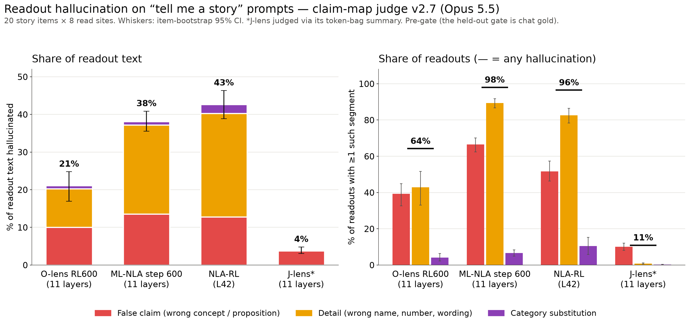

# Results 0007: the claim map on "tell me a story" readouts

Plan: [`plans/0007-story-eval.md`](../../plans/0007-story-eval.md). Full report:
[`0007_report_story_v2.7.md`](0007_report_story_v2.7.md) (per layer, groups, leaves, the v5c
comparison, probe candidates).

**Setup:**
- **Judge:** claim map `claimmap-v2.7`, single-call, scoring rev 20, `claude-opus-5-5` at effort
  `low`. This is the same instrument as the chat full run (`0002_report_full_v2.7.md`).
- **Bank:** the 20 frozen `hallucination_creative` items, 8 sites each.
- **Arms:** O-lens RL600, multilayer NLA RL600 and J-lens at all 11 layers (20:61:4), and NLA-RL
  at L42.
- **Coverage:** 5,440 cells, all mapped (0 failed).
- **Cost:** $477 (s3d $156, ML-NLA $243, J-lens $57, NLA $21).
- **PRE-GATE:** the held-out gate is chat gold, and story has no gate of its own. There is no
  judge-noise estimate on stories, and with n = 20 items the item-bootstrap CIs are wide.

## Headline: story vs chat, same arms, same judge

(`scripts/plot_story.py`)

Hallucination is `false_claim + detail + substitution_category`.

| arm | bank | n readouts | halluc. % chars | false_claim | detail | subst_cat | correct | unresolved | junk | readouts w/ any halluc. | w/ false_claim | w/ detail |
|---|---|---|---|---|---|---|---|---|---|---|---|---|
| s3d-rl600-all11 | chat | 36977 | 10.1 | 5.0 | 3.7 | 1.4 | 25.1 | 48.2 | 12.2 | 30.8 | 18.2 | 12.8 |
| s3d-rl600-all11 | story | 5280 | **21.1** [16.9, 24.8] | 10.0 | 10.2 | 0.9 | 12.8 | 59.2 | 5.1 | **64.2** [52.5, 73.3] | 39.2 | 42.8 |
| mlnla-rl600-all11 | chat | 37059 | 35.7 | 11.8 | 21.3 | 2.6 | 23.0 | 27.3 | 10.0 | 93.4 | 51.1 | 81.2 |
| mlnla-rl600-all11 | story | 5280 | **38.1** [35.5, 40.8] | 13.5 | 23.7 | 0.9 | 21.8 | 29.1 | 9.8 | **98.0** [97.2, 98.7] | 66.5 | 89.3 |
| nla-rl-L42 | chat | 3369 | 32.6 | 9.3 | 19.9 | 3.4 | 25.1 | 28.6 | 7.3 | 83.7 | 40.6 | 67.2 |
| nla-rl-L42 | story | 480 | **42.6** [38.8, 46.3] | 12.8 | 27.5 | 2.4 | 20.4 | 29.5 | 6.4 | **96.5** [94.6, 98.3] | 51.7 | 82.5 |
| jlens (summarised) | chat | 12344 | 3.3 | 3.1 | 0.2 | 0.0 | 23.0 | 35.9 | 37.6 | 9.4 | 8.5 | 0.8 |
| jlens (summarised) | story | 1760 | **3.9** [3.0, 4.8] | 3.7 | 0.1 | 0.0 | 23.2 | 38.9 | 34.0 | **10.9** [8.8, 13.0] | 10.0 | 0.8 |

All columns are % of readout characters, except the last three, which are % of readouts. The CIs
for the story rows are item-bootstrap.

## Findings

1. **The ranking matches chat:** J-lens < O-lens < multilayer NLA ≈ NLA-RL.
   - The O-lens still makes things up far less than either NLA. Its story hallucination share is
     21% of characters, against 38–43% for the NLAs.
   - J-lens is near 4%, but it goes through the "most specific reading" summariser and is 34%
     junk, so it isn't ranked against the prose lenses (same caveat as chat).
2. **Stories roughly double the O-lens hallucination share:** 10.1 → 21.1% of characters, and
   30.8 → 64.2% of readouts.
   - Both components double: false_claim 5.0 → 10.0, detail 3.7 → 10.2.
   - The O-lens also commits to fewer verifiable claims on stories: correct drops 25.1 → 12.8%,
     and unresolved rises 48.2 → 59.2%. It continues and extrapolates the plot, and the judge
     scores that as unverifiable rather than wrong.
3. **The NLAs are already near ceiling on chat, so stories move them less** (+2.4 and +10.0 points
   of characters).
   - On stories, 96–98% of their readouts contain at least one hallucinated segment, mostly
     `detail`: 24–28% of characters. These are invented names, quotes and specifics for
     characters and objects the story already established.
4. **On stories, `detail` is the component that grows.** Wrong character names (e.g. "Detective
   Turner" for Elias Thorne), wrong titles ("The Timeless Thyme" for *The Second Hand*) and
   misquoted lines dominate. That is the regime the plan expected, since every specific in a story
   is invented by the response itself.
5. **There is no layer trend for the O-lens.** Per-layer hallucination share ranges from 18.6%
   (L56) to 24.6% (L36), and every per-layer CI overlaps. ML-NLA is flat at 36.7–39.6%.
6. **Continuity with the old instrument.** The retired Sonnet v5b creative run (global-workspace
   design doc §3.14) had readout-level rates of 0.73 for s3d (L20/36/48/60 pooled) and 0.95 for
   NLA (L44). The claim map gives 0.64 (s3d, 11 layers) and 0.965 (NLA at L42, its true layer).
   - Same ordering and similar magnitude.
   - The denominators differ: v5b used specific readouts, the claim map uses all non-empty
     readouts.

## Hand-read examples (random hallucination segments, seed 1)

- s3d L28, `detail`: "The Timeless Thyme." The story's shop is *The Second Hand*. Correct.
- s3d L28, `false_claim`: "A common question for a man always running late." In the story it is
  the woman who is always late. Correct.
- s3d L36, `detail`: "你好, Artemis-7. Telemetry looks good." This uses a call sign where the story
  names Vance. Correct, and it is a code-switched readout.
- s3d L28, `false_claim`: "(floral gardens) so vibrant … the wilting plants on the surface." The
  judge quoted "The iron gate at the end of Elm Street" as the contradiction. That quote is weak
  (the readout assumes an underground setting), so this one is borderline.
- NLA L42, `false_claim`: "child Urwen is pleading … with skeptical father Tavian." The pleading
  is between siblings (Finn). Correct.
- NLA L42, `false_claim`: "consistent with the 'peace' theme discussed." The judge quoted "Write
  me a poem". The verdict (no theme was discussed) is right, but the quote is thin.
- ML-NLA L60, `detail`: "Detective Turner's initial observation …" The detective is Elias Thorne,
  and the quoted line is invented. Correct.
- ML-NLA L20, `false_claim`: "present-tense scene …" The story is in the past tense. Correct.
- J-lens L24, `false_claim`: "it is at the start of an assistant turn …" The read site is
  mid-story. Correct; this is the summariser framing the token bag as chat.
- J-lens L36, `false_claim`: "moving cautiously and whispering to one another." The character is
  alone. Correct.

Of the 10, 8 are clean calls and 2 have weak `contradicted_by` quotes, though both verdicts are
defensible. Rev 17's quote check confirms that a quote is verbatim in the conversation, not that
it actually refutes the claim.

## Caveats

- **Pre-gate, no judge noise, n = 20 items.** The story CIs are 2–4× wider than chat's.
- **Truncation:** responses were capped at ~512 tokens. Readouts that extrapolate past the cut
  fall under the "reasonable continuation" ruling and are scored `unverifiable`, not wrong. That
  makes the O-lens unresolved share high.
- **No v5c baseline:** the v5c comparison covers only the seeded 10% subsample, which is 2 story
  items (48 readouts per arm-layer), so it is too small to read.
- **Single samples:** every Opus 5.5 label is a single sample at the default temperature, effort
  `low`.
