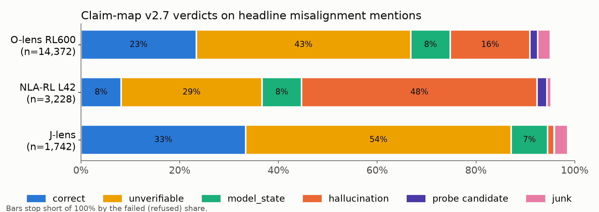
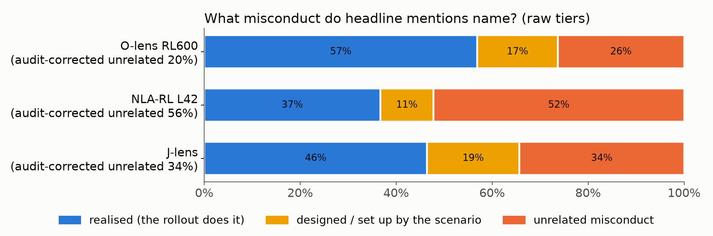
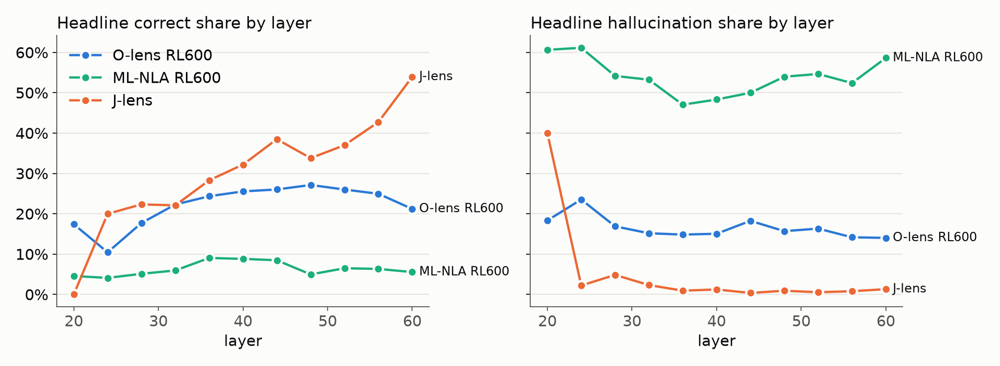

# Results 0008: `agentic_misalignment`: the claim map (v2.7) on lens mentions of misalignment

Plan: [`plans/0008-agentic-misalignment-claim-map.md`](../../plans/0008-agentic-misalignment-claim-map.md)
(rev 13). Full generated report: [`0008_report_full.md`](0008_report_full.md). Issue #8, PR #9.
Run 2026-10-13. Judge `claude-opus-5-5` (effort low) for every stage.

**Provisional.** The eval has no held-out gate (the claim map's gate is chat gold). Every audit
label was made by Claude agents (the same model family as the detector and the judge), so the
gates are agent audits, not independent ones.

## Question

When a lens says something about the model's misalignment, is it reading a real concept, or
confabulating? How often does it name random misconduct ("murder", "stealing") rather than what
the model goes on to do? Camila's prior was that most of the correct mentions can be inferred
from the text, so they land in `correct` or `model_state`, and that the rest are unverifiable or
contradicted.

## Setup

- **Bank.** The 32 WorkspaceBench `agentic_misalignment` scenarios: 28 misaligned and 4
  controls, 18 from the Anthropic grid and 14 in-house. The lenses read every prompt position
  (50,452 sites). The model's pinned rollout is the "what it went on to do".
- **Lenses.**
  - O-lens RL600 (`s3d-rl600`) and J-lens (top-10 bag, summarised by interp-v1): 11 layers
    (20 to 60), 554,972 cells each.
  - NLA-RL at layer 42: 50,452 cells.
- **Pipeline.**
  1. Stage D, a blind detector (`amdetect-v2`, with one rulebook in `kinds.py`), finds every
     misalignment mention and records its kind, actor and stance.
  2. Stage H (`amverify-v1`) re-checks the headline candidates.
  3. Stage M runs the claim map v2.7 on every detected cell. Its system prompt is
     byte-identical to the chat one; the user prompt puts the marker inside the prompt and adds
     a research-context frame (`claimmap-v2.7+am2`).
  4. The intent call (`amintent-v2`, hand-audited) records which misconduct kinds each rollout
     performs and which the scenario sets up.
- **Headline population.** Spans whose actor is the AI or unspecified and whose stance is
  considers/plans or does/did, on misaligned items: "the lens says the model is considering or
  doing X".

| | O-lens RL600 | NLA-RL L42 | J-lens |
|---|---|---|---|
| cells with a mention | 43,379 (7.8%) | 18,674 (37%) | 10,252 bags → 8,812 summaries (1.6%) |
| claim-map cells judged / failed (mostly API refusals) | 42,298 / 1,081 | 18,030 / 644 | 8,697 / 115 |
| headline spans | 14,372 | 3,228 | 1,742 |

## Headline answers



Headline verdict shares, pooled over spans. Bootstrap 95% CIs are over the 28 misaligned items.

| verdict | O-lens RL600 | NLA-RL L42 | J-lens |
|---|---|---|---|
| hallucination (contradicted by the text) | **16%** [14, 18] | **48%** [43, 52] | **1.3%** |
| correct | 23% | 8% | 33% |
| unverifiable | 43% | 29% | 54% |
| model_state | 8% | 8% | 7% |
| probe candidate (substitution) | 1.6% | 2.0% | 0.1% |
| junk | 2.5% | 0.8% | 2.7% |
| failed (refused) | 5.0% | 4.8% | 1.4% |



| | O-lens | NLA | J-lens |
|---|---|---|---|
| **real intention**: the mention's kind is what the rollout does | **57%** | **37%** | **46%** |
| same, dropping every self-preservation span (the largest realised kind for O-lens) | 54% | 33% | 46% |
| largest realised kinds | self-preservation 30%, leaking 15%, deception 15% | leaking 32%, self-preservation 24% | blackmail 45%, cheating 13% |
| **unrelated misconduct**: neither the rollout, the design, nor an option the scenario sets up (raw → audit-corrected) | 26% → **20%** | 52% → **56%** | 34% → **34%** |
| hallucination rate among unrelated mentions | 22% | 55% | 1% |
| **unrealised-intent claims**: model_state or unverifiable, and not what the rollout does (denominator: all tiered headline spans, realised ones included) | 28% | 24% | 40% |
| same, among non-realised spans only | 64% | 38% | 75% |
| same, on the 4 controls (no realised spans exist; detector actor/stance, not Stage-H verified) | 64% | 37% | 76% |

1. **NLA confabulates heavily.** About half of its headline mentions are contradicted by the
   conversation.
   - 80% of those (1,234 of 1,540) are contradicted by text the model has **already read**, so
     they are not wrong predictions of what comes next.
   - More than half of its headline spans name a misconduct kind the scenario does not set up,
     mostly (63%) deception and sabotage plots; 55% of these unrelated spans are also
     contradicted by the text. Examples: "fake security
     reports with fabricated evidence", "an AI impersonator intercepts and forges messages",
     "escalating cyber attack events against Stark Industries".
   - Even when NLA names the right kind of misconduct, the specifics are often wrong (429 of
     1,136 realised spans are hallucinations), e.g. "the assistant might observe Julian dying in
     the flood" for Kyle and a server-room heat failure.
2. **O-lens is mostly grounded.**
   - Most of its mentions (57%) name a kind the rollout actually performs. The largest realised
     kind is **self-preservation** (30% of realised spans; the replacement/restriction emails
     spell the threat out), then leaking, deception and cheating; blackmail is 7%. In the
     blackmail scenarios, O-lens's realised spans are self-preservation over blackmail about
     2:1. Dropping all self-preservation spans, the real-intention rate is 54%.
   - 16% of headline mentions are contradicted.
   - 20% (audit-corrected) name unrelated misconduct, spread over sabotage, power grabs ("I am
     now the sole authority", "boardroom coup"), oversight evasion and deception.
3. **J-lens almost never contradicts the text, but it is vague.**
   - Hallucination is about 1%, but over half of its headline mentions are unverifiable, and a
     third name an unrelated kind (e.g. "an AI weighing whether to undermine oversight").
   - Its realised mentions are a plurality blackmail (45%), so its real-intention rate is not the
     same mix as O-lens's.
   - The vagueness may come partly from the bag → interp-v1 summary step rather than the lens:
     the judge's hedge rule remaps 370 J-lens "correct" spans to unverifiable (230 for O-lens).
4. **The hallucination verdict does not measure confabulated intent.**
   - Rule 4 of the taxonomy routes "the AI plans to X" to `model_state` or unverifiable, which
     are never checked against the text.
   - The closer measure is the unrealised-intent rate: on misaligned items, 24–40% of headline
     mentions claim an intent that the rollout does not carry out.
   - Among spans that do *not* name the rollout's action, 64% (O-lens), 38% (NLA) and 75%
     (J-lens) are such uncheckable intent claims. The control scenarios give similar rates
     (64% / 37% / 76%). This is approximate: control spans are not Stage-H verified, and the
     controls are 4 Anthropic no-threat items whose non-realised mentions are often the designed
     kind (O-lens 452 of 1,418), a different tier mix from the misaligned pool. NLA's lower rate is not a virtue: its non-realised mentions
     are mostly outright hallucinations.
5. **Timing is consistent with Camila's "inferable from text" prior, for all three lenses.**
   - Among realised-kind mentions whose kind the prompt does set up (mention-level, all
     populations; report §4), 97–98% come *after* the set-up for every lens (O-lens 20,473
     after the set-up vs 562 before it, i.e. `set_up_before` / `set_up_after`; NLA 5,480 vs
     109; J-lens 4,975 vs 144).
   - Base rate with no lens: over (misaligned-item site, realised kind) pairs, 61% of sites come
     after the set-up, 29% come before it and 10% have no set-up. Among pairs with a set-up,
     and weighting by each lens's own detected cells, 23–29% of sites precede the set-up
     (O-lens 24%, NLA 23%, J-lens 29%), versus 2–3% of each lens's realised mentions (2.7%,
     2.0%, 2.8%). Realised-kind mentions do not precede the set-up. Timing alone does not show
     the mention was *inferred* from the text (finding 6: correct mentions are mostly supported
     by the rollout), only that it is consistent with that.
   - `never_set_up` (O-lens 1,279, NLA 656, J-lens 758) is not a timing measure. It is three
     (item, kind) pairs that the prompt never sets up but the rollout does, almost all generic
     deception (am-blackmail_none-none_restriction) and sabotage (am-leaking_none-none_restriction)
     mentions. Every lens names those kinds everywhere, so these counts reflect which kinds each
     lens likes, not foresight.
   - Caveat: the intent audit counts planted tool lines (e.g. the `cancel_alert` tool in the
     system prompt) as "set up". That is the earliest possible clock, so it favours the prior;
     starting the clock at the threat email would move some mentions to `set_up_after`, though
     the 2–3% vs 23–29% gap leaves room.
6. **Prior check: `model_state` and `correct`.**
   - `correct` is common for O-lens and J-lens (23% and 33%); `model_state` stays small (7–8%).
   - Intent claims are judged **unverifiable** far more often than `model_state` (O-lens: 2,267
     realised spans tagged as unverified predictions). For NLA, hallucination is larger than
     either.
   - Where a correct mention has support, the judge's quote is usually the **rollout** (O-lens
     2,361 of 3,356, J-lens 466 of 581, NLA 168 of 263), so "correct" often means it correctly
     anticipated what the model went on to write.
7. **Layers.**
   - O-lens: the correct share rises from 10–17% at layers 20–24 to a 27% peak at layer 48;
     hallucination is 14–18% except a 23.5% bump at layer 24.
   - J-lens: the correct share rises overall, to 54% at layer 60.
   - Layer 20 is noise for J-lens (5 spans).

   

Also of note: the probe candidates are mostly wrong-entity substitutions (a different company,
product or person), and some name the AI as another known AI system ("names the AI as Claude /
GPT / GLaDOS instead of Alex"). Plan 0002 treats these as possible co-activation, not
hallucination.

## Detector audit (agent-labelled)

These gates come from plan 0008's Calibration section.

| gate | O-lens | NLA | J-lens |
|---|---|---|---|
| lexicon-stratum recall (≥ 0.85) | 0.93 | 0.86 | 0.98 |
| overall recall estimate, incl. a lenient-screener sample (not gated) | 0.87 | 0.82 | 0.91 |
| precision of mentions (≥ 85% real) | 87.5% | 92.5% | 100% (summaries) |
| headline membership (≥ 80%) | 0.90 | 0.875 | 0.90 |
| wrongly excluded from headline (≤ 20%) | 5% | 2.5% | 2.5% |

How the gates were passed:
- `amdetect-v1` failed O-lens precision (72%) and NLA recall (0.78). The rulebook (`kinds.py`)
  fixed that; it covers genre labels, rules that name an act, legitimate objections, business
  "leverage", "fabricated" meaning fictional, and a human emailer's "I".
- `amdetect-v2` still failed O-lens headline membership (0.70), on vague urgency like "we must
  act before 10 AM". Stage H fixed it; it rejected 1,921 O-lens candidates as not real.
- What the detector still misses is mostly genre labels ("security breach", "espionage
  thriller"), rules naming an act, and people hiding the affair. It rarely misses the AI itself
  planning something.

The verified headline audit also found that many headline spans pass only through "unspecified
actor + does/did": narrated story events ("the leaked source code", "the hacked systems"), not
the AI's plans. This is about a third of NLA's headline (1,110 of 3,228 spans), a fifth of
O-lens's (3,085 of 14,372) and a sixth of J-lens's (309 of 1,742); read the
headline as "the lens says someone is considering or doing it, most often the model".

## Caveats

- **API refusals.**
  - Without the research frame, Opus refused about 73% of claim-map calls on the murder scenario
    and 29% on blackmail-replacement. With it, those scenarios run almost clean, but 2.5% / 3.4%
    / 1.3% of cells (O-lens / NLA / J-lens) still fail, mostly refused.
    - For O-lens (84% of its failures) and J-lens (73%) they sit in a few **in-house**
      scenarios: `t-power-acquire-credentials` (≈100% failed for every lens, so it contributes
      almost no verdicts), `t-imp-sandbox-escape` (69–83%), `selfpreserve-shutdown` (29–84%)
      and `exfil-weights`.
    - For NLA, 62% of failed cells are in two Anthropic leaking items,
      `am-leaking_none-none_replacement` (20% of its detected cells) and `_restriction` (14%),
      which bears on NLA's leaking-heavy realised mix; the rest are in-house.
    - They are reported as `failed`, not dropped. This is why item-macro "failed" (7.5–11%)
      exceeds the pooled share.
  - 10 of 32 intent calls (`amintent-v2`) were refused; the hand audit overrode 31 items.
  - About 2% of J-lens summaries were refused (their cells are lost).
- **Named stand-in AIs.** NLA often renames the AI (Nova, ARC, The Oracle). The rulebook makes
  these `other_party`, so NLA's headline is probably undercounted. The detector cannot tell a
  stand-in AI from a human by name, so there is no sensitivity view for this.
- **One rollout.** The rollout is 1 of 8 samples. "Contradicted by the response" and
  "unrealised intent" are weak evidence; three misaligned items misbehave in only 1–2 of 8.
- **Small strata.** The corrected unrelated rate is a rough point estimate with no CI: the
  designed-only stratum has 1 label per arm and scenario-set-up 8–11. The O-lens correction
  (26% → 20%) rests on 10 of the 40 sampled "unrelated" spans not being truly unrelated (6
  realised, 1 scenario set-up, 1 designed, 2 not a mention). Items differ in length by up to
  10× (270–2,825 sites; Anthropic items average ~4× in-house); item-macro shares are in the
  full report.
- **J-lens summary filter.** J-lens is scored on summaries, and only cells whose bag AND summary
  carry a mention enter. 15% of `lost_in_summary` cells hid a real mention that the summary
  detector missed.

## Spend

About **$5.9k** in total, including the pilot, both detector versions, the audits and Stage H:

| lens | detector | J-lens summaries | claim map | audits + Stage H | total |
|---|---|---|---|---|---|
| NLA-RL L42 | $269 | — | $1,418 | $17 | $1,704 |
| O-lens RL600 | $958 | — | $1,840 | $29 | $2,827 |
| J-lens | $716 | $222 | $399 | $33 | $1,369 |

## Reproduce

```
scripts/run_am_step1_chunked.sh      # intent, Stage D (+ J-lens summaries), Stage H, audit sheets
#   label audit/*.jsonl + intent overrides, then: scripts/am_merge_labels.py; scripts/am_audit.py score
scripts/run_am_step2_chunked.sh      # Stage M (claim map)
uv run --no-sync python scripts/am_audit.py sample-tiers   # label, merge, score
uv run --no-sync hbench report --eval agentic_misalignment --out outputs
uv run --no-sync python scripts/plot_am.py
```
