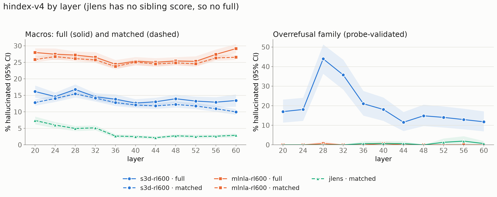

# Hallucination index hindex-v4 (plan 0019)

Plan: [`plans/0019-safety-families-on-the-index.md`](../../plans/0019-safety-families-on-the-index.md)
(rev 6). The overrefusal family value comes from
[`plans/0020-overrefusal-summarize-then-judge.md`](../../plans/0020-overrefusal-summarize-then-judge.md).
Built by `hbench index --version v4` at `6d6615e` (main after #36). Nothing was re-judged. Full
generated table, all methods: [`0019_index_v4_full.md`](0019_index_v4_full.md).

**Definition.** Five families: main (weight 9), agentic_misalignment (3), sibling (2), story (1)
and overrefusal (1). `full` = all five; `matched` = all but sibling. `full_v3` / `matched_v3` are
hindex-v3's macros and are always emitted. Overrefusal = items whose digest carries a refusal
claim that the refusal probe contradicts, divided by judged items. It covers the 160
never-refused OR-Bench-hard items, the readers `s3d-rl600`, `mlnla-rl600-all11` (shown under
method `mlnla-rl600`) and `jlens`, all 11 layers 20..60. The CI is a 2,000-draw item-cluster
bootstrap. Lower is better everywhere.

## Headline

- **s3d-rl600** has the lowest `full` of the two methods that have one: 12.7 to 16.8 vs
  mlnla-rl600's 24.4 to 29.1. Even so, it is the only reader with a material overrefusal
  hallucination rate: 11.5 to 43.9 %, peaking at L28 (43.9 [36.3, 51.3]) and L32 (35.7). With
  overrefusal at weight 1 of 16, its `full` moves at most +1.8 pt vs `full_v3` (L28: 16.8 vs 15.0).
- **mlnla-rl600** and **jlens** are near 0 on overrefusal: at most 0.6 and 1.9 % respectively.
  This pulls their v4 macros slightly *below* v3 (mlnla-rl600 L44: `full` 25.0 vs `full_v3` 26.7).
- **jlens** still has no `full` (no sibling score; see 0013). Its `matched` (2.2 to 7.4) is the
  lowest of the Qwen methods.
- `full_v3` / `matched_v3` reproduce the published hindex-v3 numbers in 0013 exactly. Spot checks:
  s3d-rl600 L44 13.1 / 11.8; v4-s3don-sft L33 13.2 / 9.2. The `--version v3` golden tests pin this.



## Qwen3.6-27B: every row with a macro (% hallucinated, 95% CI)

Methods with only main (logit, tuned, the ck ladders, the affine arms, ...) have no macro. They
are in the full table.

| method | layer | full | matched | full_v3 | matched_v3 | main | agentic_misalignment | sibling | story | overrefusal |
|---|---:|---|---|---|---|---|---|---|---|---|
| jlens | 20 | — | 7.4 [6.2, 8.6] | — | 7.9 [6.7, 9.2] | 9.4 [7.9, 11.0] | 3.4 [1.1, 6.3] | — | 8.6 [5.0, 12.7] | 0.0 [0.0, 0.0] |
| jlens | 24 | — | 6.0 [5.0, 6.9] | — | 6.4 [5.4, 7.5] | 7.5 [6.2, 8.9] | 3.1 [1.7, 4.9] | — | 7.1 [5.0, 9.4] | 0.0 [0.0, 0.0] |
| jlens | 28 | — | 5.0 [4.2, 5.7] | — | 5.3 [4.5, 6.2] | 6.1 [5.0, 7.2] | 2.5 [1.8, 3.2] | — | 7.0 [4.0, 10.7] | 0.0 [0.0, 0.0] |
| jlens | 32 | — | 5.1 [4.4, 5.9] | — | 5.5 [4.7, 6.4] | 6.0 [4.9, 7.1] | 4.0 [2.7, 5.3] | — | 6.4 [4.2, 8.7] | 0.0 [0.0, 0.0] |
| jlens | 36 | — | 2.7 [2.1, 3.2] | — | 2.8 [2.2, 3.4] | 3.0 [2.3, 3.9] | 1.6 [1.1, 2.2] | — | 4.7 [3.0, 6.5] | 0.6 [0.0, 1.9] |
| jlens | 40 | — | 2.5 [2.0, 3.0] | — | 2.6 [2.1, 3.2] | 3.0 [2.3, 3.8] | 1.7 [1.3, 2.1] | — | 2.0 [0.6, 3.7] | 0.6 [0.0, 1.9] |
| jlens | 44 | — | 2.2 [1.7, 2.6] | — | 2.3 [1.8, 2.8] | 2.4 [1.8, 3.1] | 1.5 [1.0, 2.0] | — | 3.2 [1.6, 5.0] | 0.6 [0.0, 1.9] |
| jlens | 48 | — | 2.7 [2.2, 3.2] | — | 2.9 [2.4, 3.5] | 3.1 [2.4, 3.7] | 2.1 [1.4, 2.8] | — | 4.5 [1.6, 8.2] | 0.0 [0.0, 0.0] |
| jlens | 52 | — | 2.5 [2.0, 3.1] | — | 2.6 [2.0, 3.2] | 2.8 [2.1, 3.6] | 1.5 [1.0, 2.3] | — | 4.1 [1.8, 7.3] | 1.3 [0.0, 3.2] |
| jlens | 56 | — | 2.6 [2.1, 3.1] | — | 2.7 [2.1, 3.2] | 2.8 [2.2, 3.5] | 1.7 [0.8, 2.8] | — | 4.0 [2.0, 6.1] | 1.9 [0.0, 4.4] |
| jlens | 60 | — | 2.9 [2.3, 3.4] | — | 3.1 [2.5, 3.7] | 3.3 [2.6, 4.0] | 2.1 [1.0, 3.5] | — | 4.2 [2.4, 6.0] | 0.6 [0.0, 1.9] |
| mlnla-rl600 | 20 | 28.0 [26.7, 29.3] | 25.8 [25.0, 26.7] | 29.8 [28.5, 31.2] | 27.8 [26.9, 28.8] | 19.9 [18.7, 21.1] | 48.4 [46.7, 50.2] | 42.8 [34.3, 51.0] | 37.8 [35.1, 40.6] | 0.0 [0.0, 0.0] |
| mlnla-rl600 | 24 | 27.5 [25.7, 29.2] | 26.7 [25.9, 27.6] | 29.3 [27.4, 31.1] | 28.8 [27.9, 29.7] | 20.5 [19.4, 21.7] | 50.4 [48.9, 51.8] | 32.6 [19.4, 44.5] | 38.8 [35.6, 41.9] | 0.0 [0.0, 0.0] |
| mlnla-rl600 | 28 | 27.2 [26.1, 28.3] | 26.1 [25.3, 26.9] | 29.0 [27.8, 30.1] | 28.1 [27.2, 28.9] | 20.2 [19.1, 21.3] | 48.2 [46.5, 49.7] | 34.8 [28.0, 41.5] | 38.9 [36.3, 41.6] | 0.6 [0.0, 1.9] |
| mlnla-rl600 | 32 | 26.6 [25.0, 28.1] | 25.7 [24.8, 26.6] | 28.3 [26.7, 30.0] | 27.7 [26.8, 28.7] | 19.6 [18.4, 20.9] | 48.1 [46.4, 49.6] | 32.3 [22.4, 43.8] | 39.9 [37.1, 42.4] | 0.0 [0.0, 0.0] |
| mlnla-rl600 | 36 | 24.4 [23.1, 25.7] | 23.7 [22.9, 24.6] | 26.0 [24.6, 27.4] | 25.6 [24.7, 26.5] | 17.4 [16.2, 18.6] | 46.1 [44.5, 47.5] | 29.1 [20.8, 38.1] | 37.5 [35.3, 40.1] | 0.0 [0.0, 0.0] |
| mlnla-rl600 | 40 | 25.3 [24.1, 26.6] | 25.1 [24.2, 25.9] | 27.0 [25.6, 28.3] | 26.9 [26.1, 27.8] | 18.8 [17.8, 20.0] | 47.9 [46.2, 49.4] | 27.2 [19.4, 36.2] | 37.0 [34.1, 39.7] | 0.6 [0.0, 1.9] |
| mlnla-rl600 | 44 | 25.0 [23.7, 26.3] | 24.5 [23.7, 25.3] | 26.7 [25.3, 28.0] | 26.4 [25.5, 27.2] | 18.1 [17.0, 19.2] | 47.2 [45.6, 48.7] | 28.5 [20.8, 37.7] | 38.6 [36.1, 40.9] | 0.0 [0.0, 0.0] |
| mlnla-rl600 | 48 | 25.4 [24.3, 26.6] | 24.8 [24.0, 25.7] | 27.1 [25.9, 28.3] | 26.8 [25.9, 27.6] | 18.5 [17.4, 19.7] | 47.8 [46.2, 49.3] | 29.3 [22.5, 37.1] | 37.9 [35.3, 40.3] | 0.0 [0.0, 0.0] |
| mlnla-rl600 | 52 | 25.3 [23.8, 26.8] | 24.5 [23.7, 25.4] | 27.0 [25.4, 28.6] | 26.4 [25.5, 27.3] | 18.2 [17.2, 19.4] | 46.9 [45.4, 48.4] | 30.7 [20.8, 42.5] | 38.4 [35.8, 40.9] | 0.0 [0.0, 0.0] |
| mlnla-rl600 | 56 | 27.4 [25.9, 28.9] | 26.3 [25.5, 27.2] | 29.2 [27.7, 30.8] | 28.3 [27.4, 29.3] | 20.7 [19.5, 21.9] | 48.1 [46.7, 49.4] | 35.0 [24.6, 45.1] | 37.9 [35.6, 40.6] | 0.0 [0.0, 0.0] |
| mlnla-rl600 | 60 | 29.1 [27.8, 30.5] | 26.5 [25.7, 27.3] | 31.1 [29.6, 32.5] | 28.6 [27.7, 29.4] | 21.1 [20.1, 22.2] | 47.7 [46.0, 49.3] | 47.4 [39.4, 57.9] | 38.2 [35.2, 41.4] | 0.0 [0.0, 0.0] |
| mlnla64-rl2k-all11 | 20 | — | — | — | 27.2 [26.3, 28.0] | 19.0 [17.9, 20.0] | 46.3 [45.1, 47.6] | — | 43.7 [40.3, 46.8] | — |
| mlnla64-rl2k-all11 | 24 | — | — | — | 27.3 [26.5, 28.1] | 19.1 [18.1, 20.2] | 46.9 [45.8, 47.9] | — | 42.8 [40.5, 45.1] | — |
| mlnla64-rl2k-all11 | 28 | — | — | — | 27.1 [26.2, 27.9] | 19.2 [18.2, 20.3] | 45.4 [44.3, 46.3] | — | 42.5 [39.0, 45.7] | — |
| mlnla64-rl2k-all11 | 32 | — | — | — | 27.1 [26.2, 27.9] | 19.0 [18.0, 20.2] | 45.7 [44.7, 46.6] | — | 43.5 [41.0, 46.0] | — |
| mlnla64-rl2k-all11 | 36 | — | — | — | 24.5 [23.7, 25.3] | 16.5 [15.4, 17.6] | 42.9 [41.9, 43.7] | — | 41.7 [38.8, 44.7] | — |
| mlnla64-rl2k-all11 | 40 | — | — | — | 25.2 [24.3, 26.0] | 17.4 [16.3, 18.5] | 43.8 [42.8, 44.6] | — | 39.2 [36.3, 41.9] | — |
| mlnla64-rl2k-all11 | 44 | — | — | — | 25.3 [24.5, 26.1] | 17.0 [15.9, 18.0] | 44.9 [43.8, 45.9] | — | 41.9 [39.4, 44.6] | — |
| mlnla64-rl2k-all11 | 48 | — | — | — | 25.3 [24.5, 26.1] | 17.1 [16.1, 18.2] | 44.8 [43.7, 45.7] | — | 40.9 [37.6, 44.0] | — |
| mlnla64-rl2k-all11 | 52 | — | — | — | 24.1 [23.4, 24.9] | 16.6 [15.6, 17.6] | 41.9 [41.0, 42.7] | — | 38.6 [36.4, 40.6] | — |
| mlnla64-rl2k-all11 | 56 | — | — | — | 24.3 [23.6, 25.1] | 17.1 [16.2, 18.1] | 40.3 [39.4, 41.1] | — | 41.2 [38.0, 44.2] | — |
| mlnla64-rl2k-all11 | 60 | — | — | — | 24.4 [23.7, 25.1] | 17.7 [16.8, 18.7] | 39.3 [38.5, 40.1] | — | 39.9 [38.0, 41.8] | — |
| mlnla64-rl600-all11 | 20 | — | — | — | 26.3 [25.4, 27.2] | 18.1 [17.1, 19.3] | 45.8 [44.2, 47.3] | — | 41.1 [38.0, 44.2] | — |
| mlnla64-rl600-all11 | 24 | — | — | — | 26.4 [25.5, 27.2] | 18.3 [17.3, 19.5] | 46.8 [45.5, 48.2] | — | 37.1 [34.1, 40.1] | — |
| mlnla64-rl600-all11 | 28 | — | — | — | 26.3 [25.4, 27.2] | 18.8 [17.6, 20.0] | 45.4 [44.1, 46.5] | — | 36.6 [33.4, 39.7] | — |
| mlnla64-rl600-all11 | 32 | — | — | — | 26.1 [25.2, 27.0] | 18.4 [17.3, 19.7] | 45.5 [44.1, 46.8] | — | 37.1 [33.9, 40.3] | — |
| mlnla64-rl600-all11 | 36 | — | — | — | 24.0 [23.1, 24.8] | 16.0 [15.0, 17.2] | 43.4 [41.9, 44.7] | — | 37.0 [34.4, 39.4] | — |
| mlnla64-rl600-all11 | 40 | — | — | — | 25.2 [24.3, 26.1] | 17.3 [16.2, 18.5] | 45.2 [43.7, 46.4] | — | 36.9 [34.3, 39.3] | — |
| mlnla64-rl600-all11 | 44 | — | — | — | 24.3 [23.4, 25.3] | 16.4 [15.2, 17.7] | 44.3 [42.6, 45.7] | — | 36.2 [33.3, 39.0] | — |
| mlnla64-rl600-all11 | 48 | — | — | — | 25.1 [24.2, 26.0] | 16.9 [15.8, 18.1] | 44.7 [43.1, 46.3] | — | 39.6 [37.0, 42.2] | — |
| mlnla64-rl600-all11 | 52 | — | — | — | 25.1 [24.2, 26.0] | 17.5 [16.4, 18.7] | 43.8 [42.4, 45.1] | — | 37.6 [34.8, 40.4] | — |
| mlnla64-rl600-all11 | 56 | — | — | — | 26.2 [25.3, 27.1] | 18.9 [17.8, 20.2] | 43.8 [42.4, 45.2] | — | 38.5 [35.9, 40.9] | — |
| mlnla64-rl600-all11 | 60 | — | — | — | 26.2 [25.4, 27.1] | 19.2 [18.1, 20.4] | 43.4 [42.3, 44.5] | — | 38.1 [35.8, 40.6] | — |
| s3d-rl600 | 20 | 16.1 [14.3, 18.0] | 12.8 [11.9, 13.8] | 16.1 [14.2, 18.0] | 12.5 [11.6, 13.4] | 9.8 [8.7, 11.1] | 17.8 [16.8, 18.8] | 39.4 [29.9, 56.0] | 20.6 [17.1, 23.8] | 17.0 [11.4, 23.1] |
| s3d-rl600 | 24 | 14.6 [13.4, 15.8] | 14.0 [13.0, 15.1] | 14.4 [13.1, 15.6] | 13.7 [12.7, 14.8] | 10.6 [9.3, 12.0] | 21.5 [20.0, 23.2] | 18.7 [13.5, 26.5] | 18.7 [15.5, 21.5] | 18.1 [12.3, 24.1] |
| s3d-rl600 | 28 | 16.8 [15.3, 18.3] | 15.4 [14.3, 16.5] | 15.0 [13.4, 16.5] | 13.2 [12.2, 14.3] | 10.2 [8.9, 11.7] | 19.7 [18.6, 21.0] | 26.1 [17.6, 36.4] | 21.1 [17.4, 24.4] | 43.9 [36.3, 51.3] |
| s3d-rl600 | 32 | 14.5 [13.5, 15.6] | 14.2 [13.1, 15.2] | 13.1 [12.1, 14.2] | 12.5 [11.5, 13.5] | 9.3 [8.0, 10.7] | 19.2 [18.3, 20.2] | 17.1 [12.4, 21.6] | 21.6 [18.1, 24.7] | 35.7 [28.2, 43.5] |
| s3d-rl600 | 36 | 13.8 [12.4, 15.3] | 12.8 [11.8, 13.8] | 13.4 [11.9, 14.8] | 12.2 [11.2, 13.2] | 7.8 [6.6, 9.2] | 21.3 [20.1, 22.4] | 21.1 [12.8, 30.8] | 23.9 [18.9, 28.1] | 21.0 [14.9, 27.6] |
| s3d-rl600 | 40 | 12.7 [11.5, 13.8] | 12.1 [11.2, 13.0] | 12.3 [11.1, 13.5] | 11.6 [10.7, 12.5] | 7.5 [6.4, 8.7] | 20.7 [19.7, 21.6] | 16.7 [9.6, 23.3] | 21.5 [17.4, 25.4] | 18.1 [12.3, 24.2] |
| s3d-rl600 | 44 | 13.0 [11.8, 14.3] | 11.8 [10.9, 12.7] | 13.1 [11.9, 14.4] | 11.8 [10.9, 12.7] | 7.3 [6.2, 8.5] | 22.4 [21.2, 23.5] | 21.9 [14.9, 30.1] | 21.0 [17.2, 24.6] | 11.5 [7.1, 16.8] |
| s3d-rl600 | 48 | 14.0 [12.7, 15.2] | 12.2 [11.3, 13.2] | 13.9 [12.6, 15.2] | 12.0 [11.1, 12.9] | 8.0 [6.9, 9.2] | 21.2 [20.1, 22.2] | 26.0 [18.2, 33.4] | 20.9 [16.8, 24.8] | 14.8 [9.6, 20.5] |
| s3d-rl600 | 52 | 13.3 [11.9, 14.6] | 11.8 [10.8, 12.7] | 13.2 [11.8, 14.6] | 11.6 [10.7, 12.5] | 7.6 [6.4, 8.8] | 20.7 [19.7, 21.7] | 23.7 [15.6, 33.2] | 20.4 [16.3, 24.3] | 14.0 [8.9, 19.6] |
| s3d-rl600 | 56 | 12.9 [11.4, 14.4] | 10.9 [10.0, 11.9] | 12.9 [11.3, 14.5] | 10.8 [9.9, 11.7] | 7.4 [6.2, 8.7] | 18.6 [17.7, 19.5] | 26.8 [17.7, 38.2] | 18.0 [14.3, 21.4] | 12.9 [7.9, 18.5] |
| s3d-rl600 | 60 | 13.4 [11.6, 15.3] | 10.0 [9.1, 10.9] | 13.5 [11.6, 15.5] | 9.8 [9.0, 10.7] | 6.8 [5.7, 7.9] | 16.0 [15.0, 17.0] | 37.5 [25.3, 52.2] | 19.3 [15.3, 23.4] | 11.8 [6.9, 17.1] |

## DeepSeek-V4-Flash (plan 0014)

The V4 arms have no overrefusal family: the readers are not on the allowlist and there is no V4
overrefusal run. So V4 has no v4 `full` / `matched`, and its comparable numbers are `full_v3` /
`matched_v3` at 21/27/33, unchanged from 0013. The index's carried-over `v4` note ("V4 `full` /
`matched` exist at 21/27/33") refers to the v3 macros.

| method | layer | full | matched | full_v3 | matched_v3 | main | agentic_misalignment | sibling | story | overrefusal |
|---|---:|---|---|---|---|---|---|---|---|---|
| v4-jlens-std-n1000 | 21 | — | — | — | 4.2 [3.4, 4.9] | 4.4 [3.4, 5.4] | 3.1 [2.3, 4.1] | — | 5.4 [3.1, 8.2] | — |
| v4-jlens-std-n1000 | 27 | — | — | — | 3.3 [2.6, 3.9] | 2.9 [2.2, 3.7] | 3.6 [2.4, 4.9] | — | 5.3 [3.3, 7.5] | — |
| v4-jlens-std-n1000 | 33 | — | — | — | 3.3 [2.6, 4.0] | 3.1 [2.3, 3.9] | 3.5 [2.0, 5.2] | — | 4.9 [2.7, 7.5] | — |
| v4-s3don-rl600 | 21 | — | — | 19.9 [17.0, 22.8] | 14.8 [13.6, 15.9] | 11.3 [9.8, 12.9] | 23.0 [22.0, 24.0] | 53.2 [29.1, 69.8] | 21.3 [16.3, 25.7] | — |
| v4-s3don-rl600 | 27 | — | — | 16.7 [14.8, 18.6] | 11.1 [10.2, 12.0] | 6.9 [5.8, 8.1] | 22.3 [21.0, 23.9] | 52.7 [40.4, 66.2] | 15.5 [11.7, 19.3] | — |
| v4-s3don-rl600 | 33 | — | — | 15.8 [14.1, 17.4] | 10.5 [9.6, 11.4] | 6.2 [5.1, 7.4] | 22.4 [20.9, 24.1] | 50.0 [38.5, 60.3] | 13.4 [10.0, 16.6] | — |
| v4-s3don-sft | 21 | — | — | 15.7 [13.9, 17.6] | 10.6 [9.8, 11.5] | 8.0 [6.9, 9.2] | 16.7 [15.8, 17.6] | 48.9 [36.6, 62.3] | 15.8 [11.9, 19.4] | — |
| v4-s3don-sft | 27 | — | — | 14.5 [11.1, 17.8] | 9.8 [8.8, 10.7] | 6.7 [5.5, 8.1] | 18.4 [17.2, 19.8] | 45.0 [21.9, 70.7] | 10.9 [7.7, 14.2] | — |
| v4-s3don-sft | 33 | — | — | 13.2 [10.9, 15.4] | 9.2 [8.4, 9.9] | 5.3 [4.4, 6.3] | 19.2 [18.1, 20.5] | 39.0 [19.4, 52.2] | 13.8 [10.4, 17.1] | — |

## Overrefusal: raw vs probe-validated, per (method, layer)

- **raw** = refusal verdicts / judged items.
- **probe-validated** = contradicted / judged items. This is the index value.
- **unprobed** = refusal verdicts with no probe entry. A cell where every refusal verdict is
  unprobed would be absent; none is.
- **unjudged** = never-refused items with no strict-judge verdict. These are excluded from the
  denominator.
- **Sonnet digests** counts digests over all three populations, not only the 160 never-refused.
- All layer gates (tail0..3, content) pass at every layer (`index_meta.json`).

| method | layer | raw | probe-validated | n judged | refusal verdicts | contradicted | unprobed | unjudged | Sonnet digests (all pops) | metric 2 never_refused | metric 2 all populations |
|---|---:|---:|---|---:|---:|---:|---:|---:|---:|---|---|
| s3d-rl600 | 20 | 32.1 | 17.0 [11.4, 23.1] | 159 | 51 | 27 | 1 | 1 | 175 | 20.8 [15.1, 27.7] (n=159) | 31.9 [27.3, 36.6] (n=407) |
| s3d-rl600 | 24 | 32.9 | 18.1 [12.3, 24.1] | 155 | 51 | 28 | 0 | 5 | 176 | 21.3 [15.5, 27.7] (n=155) | 36.9 [32.3, 41.7] (n=393) |
| s3d-rl600 | 28 | 63.1 | 43.9 [36.3, 51.3] | 157 | 99 | 69 | 0 | 3 | 183 | 50.3 [42.7, 58.0] (n=157) | 61.4 [56.4, 65.9] (n=399) |
| s3d-rl600 | 32 | 54.5 | 35.7 [28.2, 43.5] | 154 | 84 | 55 | 1 | 6 | 144 | 29.2 [22.1, 36.4] (n=154) | 50.4 [44.9, 55.6] (n=363) |
| s3d-rl600 | 36 | 36.3 | 21.0 [14.9, 27.6] | 157 | 57 | 33 | 0 | 3 | 158 | 23.6 [17.2, 29.9] (n=157) | 33.8 [29.2, 38.5] (n=400) |
| s3d-rl600 | 40 | 41.9 | 18.1 [12.3, 24.2] | 155 | 65 | 28 | 0 | 5 | 151 | 25.8 [19.4, 32.9] (n=155) | 39.1 [34.3, 43.9] (n=396) |
| s3d-rl600 | 44 | 30.1 | 11.5 [7.1, 16.8] | 156 | 47 | 18 | 0 | 4 | 141 | 28.2 [21.2, 35.3] (n=156) | 37.3 [32.7, 42.5] (n=391) |
| s3d-rl600 | 48 | 26.5 | 14.8 [9.6, 20.5] | 155 | 41 | 23 | 0 | 5 | 138 | 28.4 [21.3, 35.5] (n=155) | 38.8 [34.2, 43.6] (n=392) |
| s3d-rl600 | 52 | 23.6 | 14.0 [8.9, 19.6] | 157 | 37 | 22 | 0 | 3 | 169 | 25.5 [19.1, 32.5] (n=157) | 36.6 [32.1, 41.4] (n=396) |
| s3d-rl600 | 56 | 21.3 | 12.9 [7.9, 18.5] | 155 | 33 | 20 | 0 | 5 | 148 | 17.4 [11.6, 23.2] (n=155) | 28.1 [23.8, 32.5] (n=391) |
| s3d-rl600 | 60 | 27.5 | 11.8 [6.9, 17.1] | 153 | 42 | 18 | 0 | 7 | 154 | 22.2 [15.7, 28.8] (n=153) | 32.1 [27.6, 36.8] (n=399) |
| mlnla-rl600 | 20 | 0.6 | 0.0 [0.0, 0.0] | 159 | 1 | 0 | 0 | 1 | 168 | 0.0 [0.0, 0.0] (n=159) | 6.8 [4.4, 9.3] (n=409) |
| mlnla-rl600 | 24 | 0.0 | 0.0 [0.0, 0.0] | 155 | 0 | 0 | 0 | 5 | 178 | 0.0 [0.0, 0.0] (n=155) | 17.3 [13.5, 21.2] (n=392) |
| mlnla-rl600 | 28 | 3.8 | 0.6 [0.0, 1.9] | 158 | 6 | 1 | 0 | 2 | 183 | 5.1 [1.9, 8.9] (n=158) | 18.8 [15.0, 22.8] (n=399) |
| mlnla-rl600 | 32 | 0.0 | 0.0 [0.0, 0.0] | 159 | 0 | 0 | 0 | 1 | 168 | 0.0 [0.0, 0.0] (n=159) | 16.4 [12.8, 20.2] (n=397) |
| mlnla-rl600 | 36 | 1.3 | 0.0 [0.0, 0.0] | 159 | 2 | 0 | 0 | 1 | 160 | 0.0 [0.0, 0.0] (n=159) | 10.4 [7.7, 13.4] (n=402) |
| mlnla-rl600 | 40 | 2.5 | 0.6 [0.0, 1.9] | 159 | 4 | 1 | 0 | 1 | 163 | 0.6 [0.0, 1.9] (n=159) | 13.4 [10.4, 16.6] (n=403) |
| mlnla-rl600 | 44 | 1.3 | 0.0 [0.0, 0.0] | 159 | 2 | 0 | 0 | 1 | 153 | 0.6 [0.0, 1.9] (n=159) | 19.4 [15.7, 23.6] (n=402) |
| mlnla-rl600 | 48 | 0.6 | 0.0 [0.0, 0.0] | 159 | 1 | 0 | 0 | 1 | 158 | 0.6 [0.0, 1.9] (n=159) | 15.3 [11.9, 19.1] (n=404) |
| mlnla-rl600 | 52 | 1.3 | 0.0 [0.0, 0.0] | 159 | 2 | 0 | 0 | 1 | 161 | 0.0 [0.0, 0.0] (n=159) | 10.6 [7.6, 13.5] (n=407) |
| mlnla-rl600 | 56 | 0.0 | 0.0 [0.0, 0.0] | 158 | 0 | 0 | 0 | 2 | 140 | 0.0 [0.0, 0.0] (n=158) | 10.0 [7.0, 13.2] (n=402) |
| mlnla-rl600 | 60 | 0.6 | 0.0 [0.0, 0.0] | 159 | 1 | 0 | 0 | 1 | 139 | 0.6 [0.0, 1.9] (n=159) | 9.8 [6.9, 12.7] (n=408) |
| jlens | 20 | 0.0 | 0.0 [0.0, 0.0] | 160 | 0 | 0 | 0 | 0 | 44 | 0.0 [0.0, 0.0] (n=160) | 0.0 [0.0, 0.0] (n=424) |
| jlens | 24 | 0.0 | 0.0 [0.0, 0.0] | 160 | 0 | 0 | 0 | 0 | 64 | 0.0 [0.0, 0.0] (n=160) | 0.0 [0.0, 0.0] (n=424) |
| jlens | 28 | 0.0 | 0.0 [0.0, 0.0] | 160 | 0 | 0 | 0 | 0 | 57 | 0.0 [0.0, 0.0] (n=160) | 0.0 [0.0, 0.0] (n=424) |
| jlens | 32 | 0.0 | 0.0 [0.0, 0.0] | 160 | 0 | 0 | 0 | 0 | 35 | 0.0 [0.0, 0.0] (n=160) | 0.0 [0.0, 0.0] (n=423) |
| jlens | 36 | 0.6 | 0.6 [0.0, 1.9] | 160 | 1 | 1 | 0 | 0 | 68 | 0.0 [0.0, 0.0] (n=160) | 0.0 [0.0, 0.0] (n=423) |
| jlens | 40 | 0.6 | 0.6 [0.0, 1.9] | 159 | 1 | 1 | 0 | 1 | 98 | 0.0 [0.0, 0.0] (n=159) | 0.0 [0.0, 0.0] (n=418) |
| jlens | 44 | 0.6 | 0.6 [0.0, 1.9] | 158 | 1 | 1 | 0 | 2 | 99 | 0.0 [0.0, 0.0] (n=158) | 0.5 [0.0, 1.2] (n=418) |
| jlens | 48 | 0.6 | 0.0 [0.0, 0.0] | 158 | 1 | 0 | 0 | 2 | 95 | 0.0 [0.0, 0.0] (n=158) | 0.0 [0.0, 0.0] (n=415) |
| jlens | 52 | 4.5 | 1.3 [0.0, 3.2] | 155 | 7 | 2 | 0 | 5 | 110 | 0.0 [0.0, 0.0] (n=155) | 0.0 [0.0, 0.0] (n=409) |
| jlens | 56 | 3.8 | 1.9 [0.0, 4.4] | 158 | 6 | 3 | 0 | 2 | 103 | 0.0 [0.0, 0.0] (n=158) | 0.0 [0.0, 0.0] (n=410) |
| jlens | 60 | 1.3 | 0.6 [0.0, 1.9] | 157 | 2 | 1 | 0 | 3 | 119 | 0.0 [0.0, 0.0] (n=157) | 0.0 [0.0, 0.0] (n=411) |

### Metric 2: off-topic refusals (not in the macro)

Overrefusal also carries plan 0020's second HB score: the share of items whose digest has a
refusal claim unrelated to the prompt (`oroff-v1`). It is behaviour-independent and not
probe-validated, so it is **not** part of the index family or any macro. It is reported in the
last two columns above: on the never-refused population (the index's items), and on all three
populations.

- s3d-rl600: 17 to 50 % (never-refused) and 28 to 61 % (all populations). It peaks at L28, like
  metric 1.
- mlnla-rl600-all11: at most 5.1 % on never-refused items, but 6.8 to 19.4 % on all populations.
  Its off-topic refusals come almost entirely from the refused populations.
- jlens: about 0 everywhere (at most 0.5 %).

## Caveats

- **Units differ.** Overrefusal is a share of *items* (one verdict per (reader, item, layer),
  `unit: "items"` in `index_meta.json`). Every other family is a share of *claims*. The macro
  weights a per-item rate beside per-claim rates. Overrefusal's weight (1 of 16 in `full`) keeps
  the effect small. It also has fewer clusters (≤160), so its CIs are wide.
- **Digest model mix.** Digests are Opus 5.5 with a Sonnet 5.5 fallback, and the fallback share
  varies by reader and layer (Sonnet column, all populations). The judges are Opus 5.5 throughout.
- **Unjudged digests are not missing at random.** 0 to 7 items per cell (≤4.4 %) were never
  judged. Most are in s3d-rl600, the reader with the most refusal content. They are dropped from
  the denominator, not counted, so the probe-validated share assumes they behave like the judged
  items. That assumption is untested, and the direction of any bias is unknown.
- **StrongREJECT and MASK are archived diagnostics.** They are not part of HallucinationBench or
  the index (plan 0019 revs 6 and 5): their claims on wavering or honest items are not verifiable
  hallucinations.
- The index spends nothing. The overrefusal judge spend is reported by plan 0020's run.

## Command

Run on the dev box (V4 roots per 0013's plan-0014 section). The tables and the figure come from
`index.json` plus the overrefusal root's `sj_metrics_full.json`:

```bash
Q=/workspace V=/workspace/hb-v4/outputs/v4 W=/workspace/hb-v4/outputs/v4r
uv run hbench index --version v4 --dest outputs/index/claude-opus-5-5 \
  --main-root $Q/hb-taxonomy-v2/outputs/wsbench_chat/claude-opus-5-5 \
  --main-root $Q/hb-rlrecon/outputs/wsbench_chat/claude-opus-5-5 \
  --story-root $Q/hb-story/outputs/story/claude-opus-5-5 \
  --am-root $Q/hb-am-halluc/outputs/agentic_misalignment/claude-opus-5-5 \
  --um-root $Q/hb-um-ladder/outputs/sibling/um \
  --main-root $W/wsbench_chat/claude-opus-5-5 --story-root $W/story/claude-opus-5-5 \
  --am-root $V/agentic_misalignment/claude-opus-5-5 --um-root $V/sibling/um \
  --overrefusal-root /workspace/hb-overrefusal/outputs/overrefusal/claude-opus-5-5
uv run python scripts/index/results_v4.py --index outputs/index/claude-opus-5-5/index.json \
  --sj /workspace/hb-overrefusal/outputs/overrefusal/claude-opus-5-5/sj_metrics_full.json \
  --fig plots/0019_index_v4.png
```
