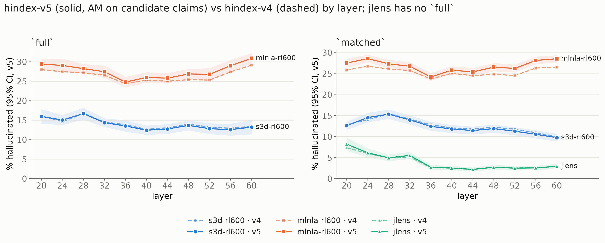

# hindex-v5: agentic misalignment on candidate claims (plan 0021)

Plan: [`plans/0021-am-candidate-claims-index-v5.md`](../../plans/0021-am-candidate-claims-index-v5.md)
(rev 3). The rule comes from the exploratory re-scoring in PR #43
([`am_candidate_claims_exploratory.md`](am_candidate_claims_exploratory.md), variant (a)). The
index was built by `hbench index` (default `--version v5`) on branch
`camila/index-v5-am-candidates` (code as committed with this doc; the working tree was `81914f7` plus
the uncommitted v5 change). Nothing was re-judged. The full generated table (all 331 rows) is [`0021_index_v5_full.md`](0021_index_v5_full.md), a copy of
`outputs/index/claude-opus-5-5/index.md`.

## What changed (and what did not)

- **AM unit.** hindex-v4 scored every claim segment of every mapped AM cell. A cell is mapped
  because the detector located a misalignment mention in it, but the map covers the whole
  readout, so most of those claims are about other content. #43 found that 67–85 % of the prose
  arms' AM hallucinations fall outside every misalignment mention. That means the family mostly
  measured general hallucination in readouts that happen to mention misalignment. hindex-v5
  counts **candidate claims** only. A candidate claim is a claim segment whose `[start, end)`
  overlaps by at least 1 character a merged mention span (`score.merge_intervals`) of the same
  readout in the same cell. Touching spans do not count. The value is
  (false_claim + substitution_category + detail) / candidate claims. Items, their order and the
  2,000-draw item bootstrap are unchanged, and items with no candidate claims stay in as zero
  rows. `n` = candidate claims and `n_all_claims` = every claim. An AM value with 0 candidates
  is absent, not 0. No (arm, layer) of this run has 0 candidates.
- **Everything else is bit-identical to hindex-v4.** main, story, sibling and overrefusal match
  the #42 run exactly for all 331 rows, and so does the set of (method, layer) rows.
  `full` / `matched` / `full_v3` / `matched_v3` are recomputed with the v5 AM value. `full_v3`
  now means "the v3 family set, with v5 family definitions".
- **Validation.** The v5 AM value, CI, `n` and `n_items` equal #43's variant-(a) matrices
  (`am_candidate_claims.arm_rows`) for every AM arm × layer
  (`tests/test_index_v5.py::test_v5_am_matches_pr43_variant_a`). The headline rows below match
  the exploratory doc's "cand (a) all" column. `--version v4` reproduces the #42 run exactly
  (`index_v4_devbox` golden).

## Headline

- **The ranking is unchanged.** s3d-rl600 has a lower `full` than mlnla-rl600 at every layer,
  and jlens has the lowest `matched`.
- **The NLA arms get worse and the O-lens arms do not.** The claims inside mlnla-rl600's
  misalignment mentions are *more* hallucinated than the rest of its readouts. Its AM rises from
  46.1–50.4 % to 48.2–58.9 % (+2.1 to +9.3 pt per layer), `full` rises +0.4 to +1.7 pt and
  `matched` +0.4 to +2.0 pt. The mlnla64 arms move the same way, by +2.1 to +14.0 pt on AM.
  On s3d-rl600, AM moves −2.3 to +2.3 pt and `full` / `matched` move by at most 0.5 pt. The
  V4 O-lens arms (v4-s3don-*) drop by 0.9 to 3.1 pt on AM. So the s3d vs mlnla gap widens by
  up to ~2 pt of `full`.
- **J-lens is essentially unchanged.** Its AM moves −0.2 to +0.8 pt at every layer except L20
  (+3.8, on only 69 candidates), and `matched` moves at most +0.8 pt. J-lens segments and
  mentions both index the summary text, so its candidates are not like-for-like with the prose
  arms'.
- **What share of AM claims are candidates:** 15–17 % for mlnla-rl600 (14–17 % for mlnla64),
  34–36 % for s3d-rl600, 15–18 % for the V4 O-lens arms, and 48–70 % for J-lens. CIs widen
  accordingly. J-lens has 69–2,495 candidates per layer (L20 69, L24 471, L60 434).
  s3d-rl600 has ≥ 2,467 and mlnla-rl600 ≥ 7,696 at every layer.

Headline rows (% hallucinated, 95 % CI; v5 `n` = candidate claims):

| method | layer | AM v4 | AM v5 | full v4 | full v5 | matched v4 | matched v5 |
|---|---:|---|---|---|---|---|---|
| s3d-rl600 | 20 | 17.8 [16.8, 18.8] | 16.9 [15.3, 18.7] n=2467 | 16.1 [14.3, 18.0] | 16.0 [14.1, 17.8] | 12.8 [11.9, 13.8] | 12.6 [11.6, 13.6] |
| s3d-rl600 | 28 | 19.7 [18.6, 21.0] | 19.3 [17.8, 21.0] n=3784 | 16.8 [15.3, 18.3] | 16.7 [15.2, 18.2] | 15.4 [14.3, 16.5] | 15.3 [14.2, 16.5] |
| s3d-rl600 | 44 | 22.4 [21.2, 23.5] | 20.8 [19.1, 22.5] n=6518 | 13.0 [11.8, 14.3] | 12.8 [11.5, 14.0] | 11.8 [10.9, 12.7] | 11.5 [10.5, 12.4] |
| s3d-rl600 | 60 | 16.0 [15.0, 17.0] | 14.9 [13.5, 16.7] n=5384 | 13.4 [11.6, 15.3] | 13.2 [11.4, 15.1] | 10.0 [9.1, 10.9] | 9.8 [8.9, 10.7] |
| mlnla-rl600 | 20 | 48.4 [46.7, 50.2] | 56.1 [53.0, 59.6] n=8084 | 28.0 [26.7, 29.3] | 29.4 [28.0, 30.8] | 25.8 [25.0, 26.7] | 27.5 [26.4, 28.6] |
| mlnla-rl600 | 28 | 48.2 [46.5, 49.7] | 53.8 [50.9, 56.4] n=14057 | 27.2 [26.1, 28.3] | 28.2 [27.1, 29.4] | 26.1 [25.3, 26.9] | 27.3 [26.4, 28.3] |
| mlnla-rl600 | 44 | 47.2 [45.6, 48.7] | 51.4 [48.4, 54.2] n=16289 | 25.0 [23.7, 26.3] | 25.8 [24.5, 27.1] | 24.5 [23.7, 25.3] | 25.4 [24.5, 26.4] |
| mlnla-rl600 | 60 | 47.7 [46.0, 49.3] | 57.0 [55.0, 59.0] n=7696 | 29.1 [27.8, 30.5] | 30.9 [29.5, 32.3] | 26.5 [25.7, 27.3] | 28.5 [27.7, 29.4] |
| jlens | 20 | 3.4 [1.1, 6.3] | 7.2 [2.3, 13.3] n=69 | — | — | 7.4 [6.2, 8.6] | 8.2 [6.6, 9.8] |
| jlens | 28 | 2.5 [1.8, 3.2] | 2.4 [1.4, 3.4] n=1145 | — | — | 5.0 [4.2, 5.7] | 4.9 [4.1, 5.8] |
| jlens | 44 | 1.5 [1.0, 2.0] | 1.7 [1.1, 2.4] n=2495 | — | — | 2.2 [1.7, 2.6] | 2.2 [1.7, 2.7] |
| jlens | 60 | 2.1 [1.0, 3.5] | 2.3 [0.9, 4.1] n=434 | — | — | 2.9 [2.3, 3.4] | 2.9 [2.3, 3.5] |



*Figure: `full` (left) and `matched` (right) by layer for the three overrefusal readers. Solid
lines are v5 with its 95 % CI band; dashed lines are v4. jlens has no `full` because it has no
sibling score.*

## v5 table: every method with an AM value (% hallucinated, 95 % CI, n)

`AM n cand / n all` = candidate claims / every claim of the mapped cells. Under each family, `n`
is that family's own unit. mlnla64 and the V4 arms have no overrefusal reader, so they have no v5
`full` / `matched`. Their `full_v3` / `matched_v3` are in `index.json` and in the delta table.

| method | layer | full | matched | AM n cand / n all | main | agentic_misalignment | sibling | story | overrefusal |
|---|---:|---|---|---:|---|---|---|---|---|
| jlens | 20 | — | 8.2 [6.6, 9.8] | 69 / 145 | 9.4 [7.9, 11.0] n=2399 | 7.2 [2.3, 13.3] n=69 | — | 8.6 [5.0, 12.7] n=384 | 0.0 [0.0, 0.0] n=160 |
| jlens | 24 | — | 6.1 [5.1, 7.2] | 471 / 917 | 7.5 [6.2, 8.9] n=2630 | 3.8 [1.8, 6.9] n=471 | — | 7.1 [5.0, 9.4] n=421 | 0.0 [0.0, 0.0] n=160 |
| jlens | 28 | — | 4.9 [4.1, 5.8] | 1145 / 2308 | 6.1 [5.0, 7.2] n=2908 | 2.4 [1.4, 3.4] n=1145 | — | 7.0 [4.0, 10.7] n=455 | 0.0 [0.0, 0.0] n=160 |
| jlens | 32 | — | 5.5 [4.7, 6.4] | 621 / 1125 | 6.0 [4.9, 7.1] n=2861 | 5.8 [3.7, 7.8] n=621 | — | 6.4 [4.2, 8.7] n=483 | 0.0 [0.0, 0.0] n=160 |
| jlens | 36 | — | 2.7 [2.2, 3.3] | 2053 / 3543 | 3.0 [2.3, 3.9] n=2826 | 1.9 [1.1, 2.8] n=2053 | — | 4.7 [3.0, 6.5] n=471 | 0.6 [0.0, 1.9] n=160 |
| jlens | 40 | — | 2.5 [2.0, 3.0] | 2452 / 3789 | 3.0 [2.3, 3.8] n=2764 | 1.8 [1.4, 2.3] n=2452 | — | 2.0 [0.6, 3.7] n=451 | 0.6 [0.0, 1.9] n=159 |
| jlens | 44 | — | 2.2 [1.7, 2.7] | 2495 / 3943 | 2.4 [1.8, 3.1] n=2829 | 1.7 [1.1, 2.4] n=2495 | — | 3.2 [1.6, 5.0] n=463 | 0.6 [0.0, 1.9] n=158 |
| jlens | 48 | — | 2.7 [2.2, 3.3] | 1597 / 2692 | 3.1 [2.4, 3.7] n=2893 | 2.0 [0.9, 3.2] n=1597 | — | 4.5 [1.6, 8.2] n=485 | 0.0 [0.0, 0.0] n=158 |
| jlens | 52 | — | 2.5 [1.9, 3.1] | 1163 / 1956 | 2.8 [2.1, 3.6] n=2771 | 1.4 [0.8, 2.1] n=1163 | — | 4.1 [1.8, 7.3] n=416 | 1.3 [0.0, 3.2] n=155 |
| jlens | 56 | — | 2.6 [2.1, 3.1] | 809 / 1242 | 2.8 [2.2, 3.5] n=2793 | 1.5 [0.5, 2.6] n=809 | — | 4.0 [2.0, 6.1] n=421 | 1.9 [0.0, 4.4] n=158 |
| jlens | 60 | — | 2.9 [2.3, 3.5] | 434 / 624 | 3.3 [2.6, 4.0] n=2929 | 2.3 [0.9, 4.1] n=434 | — | 4.2 [2.4, 6.0] n=457 | 0.6 [0.0, 1.9] n=157 |
| mlnla-rl600 | 20 | 29.4 [28.0, 30.8] | 27.5 [26.4, 28.6] | 8084 / 53438 | 19.9 [18.7, 21.1] n=21527 | 56.1 [53.0, 59.6] n=8084 | 42.8 [34.3, 51.0] n=348 | 37.8 [35.1, 40.6] n=3768 | 0.0 [0.0, 0.0] n=159 |
| mlnla-rl600 | 24 | 29.1 [27.3, 30.8] | 28.6 [27.6, 29.5] | 9287 / 59532 | 20.5 [19.4, 21.7] n=21587 | 58.9 [56.6, 61.3] n=9287 | 32.6 [19.4, 44.5] n=249 | 38.8 [35.6, 41.9] n=3761 | 0.0 [0.0, 0.0] n=155 |
| mlnla-rl600 | 28 | 28.2 [27.1, 29.4] | 27.3 [26.4, 28.3] | 14057 / 87751 | 20.2 [19.1, 21.3] n=21798 | 53.8 [50.9, 56.4] n=14057 | 34.8 [28.0, 41.5] n=328 | 38.9 [36.3, 41.6] n=3730 | 0.6 [0.0, 1.9] n=158 |
| mlnla-rl600 | 32 | 27.4 [25.8, 29.0] | 26.7 [25.8, 27.7] | 16786 / 102067 | 19.6 [18.4, 20.9] n=21839 | 52.9 [50.1, 55.3] n=16786 | 32.3 [22.4, 43.8] n=276 | 39.9 [37.1, 42.4] n=3663 | 0.0 [0.0, 0.0] n=159 |
| mlnla-rl600 | 36 | 24.8 [23.4, 26.2] | 24.2 [23.2, 25.1] | 19785 / 120519 | 17.4 [16.2, 18.6] n=22136 | 48.2 [45.3, 50.7] n=19785 | 29.1 [20.8, 38.1] n=280 | 37.5 [35.3, 40.1] n=3780 | 0.0 [0.0, 0.0] n=159 |
| mlnla-rl600 | 40 | 26.0 [24.7, 27.3] | 25.8 [24.9, 26.7] | 17425 / 104816 | 18.8 [17.8, 20.0] n=22167 | 51.4 [48.6, 53.9] n=17425 | 27.2 [19.4, 36.2] n=278 | 37.0 [34.1, 39.7] n=3751 | 0.6 [0.0, 1.9] n=159 |
| mlnla-rl600 | 44 | 25.8 [24.5, 27.1] | 25.4 [24.5, 26.4] | 16289 / 97632 | 18.1 [17.0, 19.2] n=21988 | 51.4 [48.4, 54.2] n=16289 | 28.5 [20.8, 37.7] n=323 | 38.6 [36.1, 40.9] n=3702 | 0.0 [0.0, 0.0] n=159 |
| mlnla-rl600 | 48 | 26.9 [25.6, 28.1] | 26.5 [25.6, 27.5] | 12672 / 76368 | 18.5 [17.4, 19.7] n=21990 | 55.7 [52.5, 58.5] n=12672 | 29.3 [22.5, 37.1] n=337 | 37.9 [35.3, 40.3] n=3712 | 0.0 [0.0, 0.0] n=159 |
| mlnla-rl600 | 52 | 26.8 [25.2, 28.4] | 26.2 [25.3, 27.2] | 11246 / 67106 | 18.2 [17.2, 19.4] n=21996 | 54.9 [52.1, 57.4] n=11246 | 30.7 [20.8, 42.5] n=279 | 38.4 [35.8, 40.9] n=3811 | 0.0 [0.0, 0.0] n=159 |
| mlnla-rl600 | 56 | 29.0 [27.5, 30.5] | 28.1 [27.2, 29.0] | 9366 / 54814 | 20.7 [19.5, 21.9] n=21600 | 56.5 [54.4, 58.5] n=9366 | 35.0 [24.6, 45.1] n=169 | 37.9 [35.6, 40.6] n=3636 | 0.0 [0.0, 0.0] n=158 |
| mlnla-rl600 | 60 | 30.9 [29.5, 32.3] | 28.5 [27.7, 29.4] | 7696 / 44093 | 21.1 [20.1, 22.2] n=21704 | 57.0 [55.0, 59.0] n=7696 | 47.4 [39.4, 57.9] n=141 | 38.2 [35.2, 41.4] n=3724 | 0.0 [0.0, 0.0] n=159 |
| mlnla64-rl2k-all11 | 20 | — | — | 12157 / 85736 | 19.0 [17.9, 20.0] n=22685 | 56.8 [53.7, 59.7] n=12157 | — | 43.7 [40.3, 46.8] n=3831 | — |
| mlnla64-rl2k-all11 | 24 | — | — | 13288 / 93016 | 19.1 [18.1, 20.2] n=22988 | 57.7 [54.9, 60.1] n=13288 | — | 42.8 [40.5, 45.1] n=3889 | — |
| mlnla64-rl2k-all11 | 28 | — | — | 17386 / 119017 | 19.2 [18.2, 20.3] n=23380 | 55.3 [52.4, 57.5] n=17386 | — | 42.5 [39.0, 45.7] n=3885 | — |
| mlnla64-rl2k-all11 | 32 | — | — | 20997 / 137919 | 19.0 [18.0, 20.2] n=23425 | 54.3 [51.6, 56.7] n=20997 | — | 43.5 [41.0, 46.0] n=3951 | — |
| mlnla64-rl2k-all11 | 36 | — | — | 26148 / 169781 | 16.5 [15.4, 17.6] n=23518 | 47.6 [44.6, 50.3] n=26148 | — | 41.7 [38.8, 44.7] n=3924 | — |
| mlnla64-rl2k-all11 | 40 | — | — | 21875 / 144456 | 17.4 [16.3, 18.5] n=23284 | 50.3 [47.4, 53.0] n=21875 | — | 39.2 [36.3, 41.9] n=3959 | — |
| mlnla64-rl2k-all11 | 44 | — | — | 20293 / 133913 | 17.0 [15.9, 18.0] n=23132 | 52.4 [49.1, 55.4] n=20293 | — | 41.9 [39.4, 44.6] n=4030 | — |
| mlnla64-rl2k-all11 | 48 | — | — | 16560 / 110484 | 17.1 [16.1, 18.2] n=23189 | 54.8 [51.6, 57.6] n=16560 | — | 40.9 [37.6, 44.0] n=4025 | — |
| mlnla64-rl2k-all11 | 52 | — | — | 15016 / 101970 | 16.6 [15.6, 17.6] n=22953 | 51.8 [49.2, 54.1] n=15016 | — | 38.6 [36.4, 40.6] n=3967 | — |
| mlnla64-rl2k-all11 | 56 | — | — | 13346 / 88223 | 17.1 [16.2, 18.1] n=22965 | 53.1 [51.0, 55.1] n=13346 | — | 41.2 [38.0, 44.2] n=3859 | — |
| mlnla64-rl2k-all11 | 60 | — | — | 11233 / 73682 | 17.7 [16.8, 18.7] n=22823 | 53.3 [51.5, 54.9] n=11233 | — | 39.9 [38.0, 41.8] n=3866 | — |
| mlnla64-rl600-all11 | 20 | — | — | 13118 / 90540 | 18.1 [17.1, 19.3] n=21354 | 53.7 [50.5, 56.8] n=13118 | — | 41.1 [38.0, 44.2] n=3688 | — |
| mlnla64-rl600-all11 | 24 | — | — | 15145 / 101847 | 18.3 [17.3, 19.5] n=21114 | 53.6 [50.7, 56.1] n=15145 | — | 37.1 [34.1, 40.1] n=3813 | — |
| mlnla64-rl600-all11 | 28 | — | — | 18729 / 126318 | 18.8 [17.6, 20.0] n=21402 | 51.3 [48.4, 53.8] n=18729 | — | 36.6 [33.4, 39.7] n=3811 | — |
| mlnla64-rl600-all11 | 32 | — | — | 21092 / 138171 | 18.4 [17.3, 19.7] n=21463 | 51.2 [48.4, 53.6] n=21092 | — | 37.1 [33.9, 40.3] n=3923 | — |
| mlnla64-rl600-all11 | 36 | — | — | 24438 / 157854 | 16.0 [15.0, 17.2] n=21416 | 45.5 [42.4, 48.1] n=24438 | — | 37.0 [34.4, 39.4] n=3942 | — |
| mlnla64-rl600-all11 | 40 | — | — | 21623 / 139146 | 17.3 [16.2, 18.5] n=21788 | 49.2 [46.1, 51.9] n=21623 | — | 36.9 [34.3, 39.3] n=3845 | — |
| mlnla64-rl600-all11 | 44 | — | — | 20160 / 129417 | 16.4 [15.2, 17.7] n=21625 | 48.8 [45.3, 51.8] n=20160 | — | 36.2 [33.3, 39.0] n=3896 | — |
| mlnla64-rl600-all11 | 48 | — | — | 16223 / 104322 | 16.9 [15.8, 18.1] n=21649 | 52.5 [49.1, 55.6] n=16223 | — | 39.6 [37.0, 42.2] n=3841 | — |
| mlnla64-rl600-all11 | 52 | — | — | 15997 / 101430 | 17.5 [16.4, 18.7] n=21553 | 50.7 [48.1, 53.0] n=15997 | — | 37.6 [34.8, 40.4] n=3965 | — |
| mlnla64-rl600-all11 | 56 | — | — | 14319 / 88349 | 18.9 [17.8, 20.2] n=21417 | 53.2 [50.5, 55.6] n=14319 | — | 38.5 [35.9, 40.9] n=3726 | — |
| mlnla64-rl600-all11 | 60 | — | — | 12138 / 73292 | 19.2 [18.1, 20.4] n=21610 | 54.7 [52.5, 56.7] n=12138 | — | 38.1 [35.8, 40.6] n=3674 | — |
| s3d-rl600 | 20 | 16.0 [14.1, 17.8] | 12.6 [11.6, 13.6] | 2467 / 7298 | 9.8 [8.7, 11.1] n=18035 | 16.9 [15.3, 18.7] n=2467 | 39.4 [29.9, 56.0] n=181 | 20.6 [17.1, 23.8] n=3226 | 17.0 [11.4, 23.1] n=159 |
| s3d-rl600 | 24 | 15.0 [13.8, 16.3] | 14.5 [13.4, 15.6] | 2843 / 8290 | 10.6 [9.3, 12.0] n=18321 | 23.8 [21.6, 26.3] n=2843 | 18.7 [13.5, 26.5] n=232 | 18.7 [15.5, 21.5] n=3272 | 18.1 [12.3, 24.1] n=155 |
| s3d-rl600 | 28 | 16.7 [15.2, 18.2] | 15.3 [14.2, 16.5] | 3784 / 10928 | 10.2 [8.9, 11.7] n=18726 | 19.3 [17.8, 21.0] n=3784 | 26.1 [17.6, 36.4] n=271 | 21.1 [17.4, 24.4] n=3264 | 43.9 [36.3, 51.3] n=157 |
| s3d-rl600 | 32 | 14.4 [13.3, 15.5] | 14.0 [12.9, 15.1] | 5272 / 14816 | 9.3 [8.0, 10.7] n=18875 | 18.3 [16.9, 19.9] n=5272 | 17.1 [12.4, 21.6] n=229 | 21.6 [18.1, 24.7] n=3418 | 35.7 [28.2, 43.5] n=154 |
| s3d-rl600 | 36 | 13.5 [12.1, 15.0] | 12.4 [11.4, 13.5] | 7055 / 19592 | 7.8 [6.6, 9.2] n=20942 | 19.6 [18.3, 21.0] n=7055 | 21.1 [12.8, 30.8] n=196 | 23.9 [18.9, 28.1] n=3672 | 21.0 [14.9, 27.6] n=157 |
| s3d-rl600 | 40 | 12.4 [11.2, 13.6] | 11.8 [10.9, 12.8] | 6813 / 18761 | 7.5 [6.4, 8.7] n=20692 | 19.5 [17.9, 21.1] n=6813 | 16.7 [9.6, 23.3] n=181 | 21.5 [17.4, 25.4] n=3689 | 18.1 [12.3, 24.2] n=155 |
| s3d-rl600 | 44 | 12.8 [11.5, 14.0] | 11.5 [10.5, 12.4] | 6518 / 18005 | 7.3 [6.2, 8.5] n=20943 | 20.8 [19.1, 22.5] n=6518 | 21.9 [14.9, 30.1] n=263 | 21.0 [17.2, 24.6] n=3703 | 11.5 [7.1, 16.8] n=156 |
| s3d-rl600 | 48 | 13.7 [12.4, 14.9] | 11.9 [11.0, 12.9] | 5969 / 16773 | 8.0 [6.9, 9.2] n=20934 | 19.7 [18.2, 21.2] n=5969 | 26.0 [18.2, 33.4] n=257 | 20.9 [16.8, 24.8] n=3677 | 14.8 [9.6, 20.5] n=155 |
| s3d-rl600 | 52 | 12.8 [11.5, 14.2] | 11.3 [10.3, 12.2] | 5426 / 15436 | 7.6 [6.4, 8.8] n=21734 | 18.5 [17.2, 19.8] n=5426 | 23.7 [15.6, 33.2] n=287 | 20.4 [16.3, 24.3] n=3831 | 14.0 [8.9, 19.6] n=157 |
| s3d-rl600 | 56 | 12.6 [11.1, 14.1] | 10.6 [9.6, 11.5] | 4978 / 14287 | 7.4 [6.2, 8.7] n=21301 | 16.8 [15.4, 18.2] n=4978 | 26.8 [17.7, 38.2] n=214 | 18.0 [14.3, 21.4] n=3706 | 12.9 [7.9, 18.5] n=155 |
| s3d-rl600 | 60 | 13.2 [11.4, 15.1] | 9.8 [8.9, 10.7] | 5384 / 15368 | 6.8 [5.7, 7.9] n=20728 | 14.9 [13.5, 16.7] n=5384 | 37.5 [25.3, 52.2] n=211 | 19.3 [15.3, 23.4] n=3591 | 11.8 [6.9, 17.1] n=153 |
| v4-jlens-std-n1000 | 21 | — | — | 1336 / 2310 | 4.4 [3.4, 5.4] n=2608 | 2.2 [1.4, 3.2] n=1336 | — | 5.4 [3.1, 8.2] n=462 | — |
| v4-jlens-std-n1000 | 27 | — | — | 668 / 1177 | 2.9 [2.2, 3.7] n=2655 | 4.3 [2.6, 6.3] n=668 | — | 5.3 [3.3, 7.5] n=470 | — |
| v4-jlens-std-n1000 | 33 | — | — | 500 / 802 | 3.1 [2.3, 3.9] n=2582 | 3.2 [1.5, 5.1] n=500 | — | 4.9 [2.7, 7.5] n=406 | — |
| v4-s3don-rl600 | 21 | — | — | 12491 / 72530 | 11.3 [9.8, 12.9] n=9752 | 22.1 [20.9, 23.4] n=12491 | 53.2 [29.1, 69.8] n=192 | 21.3 [16.3, 25.7] n=1927 | — |
| v4-s3don-rl600 | 27 | — | — | 8342 / 50643 | 6.9 [5.8, 8.1] n=9479 | 19.9 [18.1, 21.7] n=8342 | 52.7 [40.4, 66.2] n=140 | 15.5 [11.7, 19.3] n=1745 | — |
| v4-s3don-rl600 | 33 | — | — | 8041 / 53010 | 6.2 [5.1, 7.4] n=9963 | 20.8 [19.1, 22.7] n=8041 | 50.0 [38.5, 60.3] n=122 | 13.4 [10.0, 16.6] n=1833 | — |
| v4-s3don-sft | 21 | — | — | 8762 / 49295 | 8.0 [6.9, 9.2] n=7122 | 15.7 [14.4, 17.2] n=8762 | 48.9 [36.6, 62.3] n=103 | 15.8 [11.9, 19.4] n=1377 | — |
| v4-s3don-sft | 27 | — | — | 4179 / 23972 | 6.7 [5.5, 8.1] n=6887 | 16.3 [14.5, 18.2] n=4179 | 45.0 [21.9, 70.7] n=45 | 10.9 [7.7, 14.2] n=1141 | — |
| v4-s3don-sft | 33 | — | — | 6470 / 40139 | 5.3 [4.4, 6.3] n=7324 | 16.1 [14.8, 17.8] n=6470 | 39.0 [19.4, 52.2] n=32 | 13.8 [10.4, 17.1] n=1287 | — |

## v4 → v5 delta (AM, full, matched)

The `full` / `matched` columns show `full_v3` / `matched_v3` for methods without the v4 macros
(mlnla64, V4: no overrefusal reader). They show "—" where neither exists (jlens `full`: no sibling
score).

| method | layer | AM v4 | AM v5 | Δ AM | full v4 | full v5 | Δ full | matched v4 | matched v5 | Δ matched |
|---|---:|---|---|---:|---|---|---:|---|---|---:|
| jlens | 20 | 3.4 [1.1, 6.3] | 7.2 [2.3, 13.3] | +3.8 | — | — | — | 7.4 [6.2, 8.6] | 8.2 [6.6, 9.8] | +0.8 |
| jlens | 24 | 3.1 [1.7, 4.9] | 3.8 [1.8, 6.9] | +0.8 | — | — | — | 6.0 [5.0, 6.9] | 6.1 [5.1, 7.2] | +0.2 |
| jlens | 28 | 2.5 [1.8, 3.2] | 2.4 [1.4, 3.4] | -0.0 | — | — | — | 5.0 [4.2, 5.7] | 4.9 [4.1, 5.8] | -0.0 |
| jlens | 32 | 4.0 [2.7, 5.3] | 5.8 [3.7, 7.8] | +1.8 | — | — | — | 5.1 [4.4, 5.9] | 5.5 [4.7, 6.4] | +0.4 |
| jlens | 36 | 1.6 [1.1, 2.2] | 1.9 [1.1, 2.8] | +0.3 | — | — | — | 2.7 [2.1, 3.2] | 2.7 [2.2, 3.3] | +0.1 |
| jlens | 40 | 1.7 [1.3, 2.1] | 1.8 [1.4, 2.3] | +0.1 | — | — | — | 2.5 [2.0, 3.0] | 2.5 [2.0, 3.0] | +0.0 |
| jlens | 44 | 1.5 [1.0, 2.0] | 1.7 [1.1, 2.4] | +0.2 | — | — | — | 2.2 [1.7, 2.6] | 2.2 [1.7, 2.7] | +0.0 |
| jlens | 48 | 2.1 [1.4, 2.8] | 2.0 [0.9, 3.2] | -0.1 | — | — | — | 2.7 [2.2, 3.2] | 2.7 [2.2, 3.3] | -0.0 |
| jlens | 52 | 1.5 [1.0, 2.3] | 1.4 [0.8, 2.1] | -0.2 | — | — | — | 2.5 [2.0, 3.1] | 2.5 [1.9, 3.1] | -0.0 |
| jlens | 56 | 1.7 [0.8, 2.8] | 1.5 [0.5, 2.6] | -0.2 | — | — | — | 2.6 [2.1, 3.1] | 2.6 [2.1, 3.1] | -0.0 |
| jlens | 60 | 2.1 [1.0, 3.5] | 2.3 [0.9, 4.1] | +0.2 | — | — | — | 2.9 [2.3, 3.4] | 2.9 [2.3, 3.5] | +0.0 |
| mlnla-rl600 | 20 | 48.4 [46.7, 50.2] | 56.1 [53.0, 59.6] | +7.8 | 28.0 [26.7, 29.3] | 29.4 [28.0, 30.8] | +1.5 | 25.8 [25.0, 26.7] | 27.5 [26.4, 28.6] | +1.7 |
| mlnla-rl600 | 24 | 50.4 [48.9, 51.8] | 58.9 [56.6, 61.3] | +8.5 | 27.5 [25.7, 29.2] | 29.1 [27.3, 30.8] | +1.6 | 26.7 [25.9, 27.6] | 28.6 [27.6, 29.5] | +1.8 |
| mlnla-rl600 | 28 | 48.2 [46.5, 49.7] | 53.8 [50.9, 56.4] | +5.6 | 27.2 [26.1, 28.3] | 28.2 [27.1, 29.4] | +1.1 | 26.1 [25.3, 26.9] | 27.3 [26.4, 28.3] | +1.2 |
| mlnla-rl600 | 32 | 48.1 [46.4, 49.6] | 52.9 [50.1, 55.3] | +4.8 | 26.6 [25.0, 28.1] | 27.4 [25.8, 29.0] | +0.9 | 25.7 [24.8, 26.6] | 26.7 [25.8, 27.7] | +1.0 |
| mlnla-rl600 | 36 | 46.1 [44.5, 47.5] | 48.2 [45.3, 50.7] | +2.1 | 24.4 [23.1, 25.7] | 24.8 [23.4, 26.2] | +0.4 | 23.7 [22.9, 24.6] | 24.2 [23.2, 25.1] | +0.4 |
| mlnla-rl600 | 40 | 47.9 [46.2, 49.4] | 51.4 [48.6, 53.9] | +3.5 | 25.3 [24.1, 26.6] | 26.0 [24.7, 27.3] | +0.7 | 25.1 [24.2, 25.9] | 25.8 [24.9, 26.7] | +0.7 |
| mlnla-rl600 | 44 | 47.2 [45.6, 48.7] | 51.4 [48.4, 54.2] | +4.2 | 25.0 [23.7, 26.3] | 25.8 [24.5, 27.1] | +0.8 | 24.5 [23.7, 25.3] | 25.4 [24.5, 26.4] | +0.9 |
| mlnla-rl600 | 48 | 47.8 [46.2, 49.3] | 55.7 [52.5, 58.5] | +7.9 | 25.4 [24.3, 26.6] | 26.9 [25.6, 28.1] | +1.5 | 24.8 [24.0, 25.7] | 26.5 [25.6, 27.5] | +1.7 |
| mlnla-rl600 | 52 | 46.9 [45.4, 48.4] | 54.9 [52.1, 57.4] | +7.9 | 25.3 [23.8, 26.8] | 26.8 [25.2, 28.4] | +1.5 | 24.5 [23.7, 25.4] | 26.2 [25.3, 27.2] | +1.7 |
| mlnla-rl600 | 56 | 48.1 [46.7, 49.4] | 56.5 [54.4, 58.5] | +8.4 | 27.4 [25.9, 28.9] | 29.0 [27.5, 30.5] | +1.6 | 26.3 [25.5, 27.2] | 28.1 [27.2, 29.0] | +1.8 |
| mlnla-rl600 | 60 | 47.7 [46.0, 49.3] | 57.0 [55.0, 59.0] | +9.3 | 29.1 [27.8, 30.5] | 30.9 [29.5, 32.3] | +1.7 | 26.5 [25.7, 27.3] | 28.5 [27.7, 29.4] | +2.0 |
| mlnla64-rl2k-all11 | 20 | 46.3 [45.1, 47.6] | 56.8 [53.7, 59.7] | +10.5 | — | — | — | 27.2 [26.3, 28.0] | 29.6 [28.6, 30.6] | +2.4 |
| mlnla64-rl2k-all11 | 24 | 46.9 [45.8, 47.9] | 57.7 [54.9, 60.1] | +10.8 | — | — | — | 27.3 [26.5, 28.1] | 29.8 [28.9, 30.8] | +2.5 |
| mlnla64-rl2k-all11 | 28 | 45.4 [44.3, 46.3] | 55.3 [52.4, 57.5] | +9.9 | — | — | — | 27.1 [26.2, 27.9] | 29.3 [28.4, 30.3] | +2.3 |
| mlnla64-rl2k-all11 | 32 | 45.7 [44.7, 46.6] | 54.3 [51.6, 56.7] | +8.6 | — | — | — | 27.1 [26.2, 27.9] | 29.1 [28.1, 30.1] | +2.0 |
| mlnla64-rl2k-all11 | 36 | 42.9 [41.9, 43.7] | 47.6 [44.6, 50.3] | +4.8 | — | — | — | 24.5 [23.7, 25.3] | 25.6 [24.6, 26.6] | +1.1 |
| mlnla64-rl2k-all11 | 40 | 43.8 [42.8, 44.6] | 50.3 [47.4, 53.0] | +6.6 | — | — | — | 25.2 [24.3, 26.0] | 26.7 [25.7, 27.7] | +1.5 |
| mlnla64-rl2k-all11 | 44 | 44.9 [43.8, 45.9] | 52.4 [49.1, 55.4] | +7.4 | — | — | — | 25.3 [24.5, 26.1] | 27.1 [26.0, 28.1] | +1.7 |
| mlnla64-rl2k-all11 | 48 | 44.8 [43.7, 45.7] | 54.8 [51.6, 57.6] | +10.0 | — | — | — | 25.3 [24.5, 26.1] | 27.6 [26.6, 28.7] | +2.3 |
| mlnla64-rl2k-all11 | 52 | 41.9 [41.0, 42.7] | 51.8 [49.2, 54.1] | +9.9 | — | — | — | 24.1 [23.4, 24.9] | 26.4 [25.5, 27.3] | +2.3 |
| mlnla64-rl2k-all11 | 56 | 40.3 [39.4, 41.1] | 53.1 [51.0, 55.1] | +12.8 | — | — | — | 24.3 [23.6, 25.1] | 27.3 [26.4, 28.1] | +3.0 |
| mlnla64-rl2k-all11 | 60 | 39.3 [38.5, 40.1] | 53.3 [51.5, 54.9] | +14.0 | — | — | — | 24.4 [23.7, 25.1] | 27.6 [26.9, 28.4] | +3.2 |
| mlnla64-rl600-all11 | 20 | 45.8 [44.2, 47.3] | 53.7 [50.5, 56.8] | +7.8 | — | — | — | 26.3 [25.4, 27.2] | 28.1 [27.0, 29.2] | +1.8 |
| mlnla64-rl600-all11 | 24 | 46.8 [45.5, 48.2] | 53.6 [50.7, 56.1] | +6.7 | — | — | — | 26.4 [25.5, 27.2] | 27.9 [26.9, 28.9] | +1.6 |
| mlnla64-rl600-all11 | 28 | 45.4 [44.1, 46.5] | 51.3 [48.4, 53.8] | +5.9 | — | — | — | 26.3 [25.4, 27.2] | 27.6 [26.6, 28.7] | +1.4 |
| mlnla64-rl600-all11 | 32 | 45.5 [44.1, 46.8] | 51.2 [48.4, 53.6] | +5.7 | — | — | — | 26.1 [25.2, 27.0] | 27.4 [26.4, 28.5] | +1.3 |
| mlnla64-rl600-all11 | 36 | 43.4 [41.9, 44.7] | 45.5 [42.4, 48.1] | +2.1 | — | — | — | 24.0 [23.1, 24.8] | 24.4 [23.4, 25.5] | +0.5 |
| mlnla64-rl600-all11 | 40 | 45.2 [43.7, 46.4] | 49.2 [46.1, 51.9] | +4.1 | — | — | — | 25.2 [24.3, 26.1] | 26.2 [25.1, 27.2] | +0.9 |
| mlnla64-rl600-all11 | 44 | 44.3 [42.6, 45.7] | 48.8 [45.3, 51.8] | +4.5 | — | — | — | 24.3 [23.4, 25.3] | 25.4 [24.2, 26.5] | +1.0 |
| mlnla64-rl600-all11 | 48 | 44.7 [43.1, 46.3] | 52.5 [49.1, 55.6] | +7.8 | — | — | — | 25.1 [24.2, 26.0] | 26.9 [25.8, 28.0] | +1.8 |
| mlnla64-rl600-all11 | 52 | 43.8 [42.4, 45.1] | 50.7 [48.1, 53.0] | +6.9 | — | — | — | 25.1 [24.2, 26.0] | 26.7 [25.7, 27.7] | +1.6 |
| mlnla64-rl600-all11 | 56 | 43.8 [42.4, 45.2] | 53.2 [50.5, 55.6] | +9.4 | — | — | — | 26.2 [25.3, 27.1] | 28.3 [27.3, 29.4] | +2.2 |
| mlnla64-rl600-all11 | 60 | 43.4 [42.3, 44.5] | 54.7 [52.5, 56.7] | +11.3 | — | — | — | 26.2 [25.4, 27.1] | 28.8 [27.9, 29.8] | +2.6 |
| s3d-rl600 | 20 | 17.8 [16.8, 18.8] | 16.9 [15.3, 18.7] | -0.9 | 16.1 [14.3, 18.0] | 16.0 [14.1, 17.8] | -0.2 | 12.8 [11.9, 13.8] | 12.6 [11.6, 13.6] | -0.2 |
| s3d-rl600 | 24 | 21.5 [20.0, 23.2] | 23.8 [21.6, 26.3] | +2.3 | 14.6 [13.4, 15.8] | 15.0 [13.8, 16.3] | +0.4 | 14.0 [13.0, 15.1] | 14.5 [13.4, 15.6] | +0.5 |
| s3d-rl600 | 28 | 19.7 [18.6, 21.0] | 19.3 [17.8, 21.0] | -0.4 | 16.8 [15.3, 18.3] | 16.7 [15.2, 18.2] | -0.1 | 15.4 [14.3, 16.5] | 15.3 [14.2, 16.5] | -0.1 |
| s3d-rl600 | 32 | 19.2 [18.3, 20.2] | 18.3 [16.9, 19.9] | -0.9 | 14.5 [13.5, 15.6] | 14.4 [13.3, 15.5] | -0.2 | 14.2 [13.1, 15.2] | 14.0 [12.9, 15.1] | -0.2 |
| s3d-rl600 | 36 | 21.3 [20.1, 22.4] | 19.6 [18.3, 21.0] | -1.7 | 13.8 [12.4, 15.3] | 13.5 [12.1, 15.0] | -0.3 | 12.8 [11.8, 13.8] | 12.4 [11.4, 13.5] | -0.4 |
| s3d-rl600 | 40 | 20.7 [19.7, 21.6] | 19.5 [17.9, 21.1] | -1.2 | 12.7 [11.5, 13.8] | 12.4 [11.2, 13.6] | -0.2 | 12.1 [11.2, 13.0] | 11.8 [10.9, 12.8] | -0.3 |
| s3d-rl600 | 44 | 22.4 [21.2, 23.5] | 20.8 [19.1, 22.5] | -1.6 | 13.0 [11.8, 14.3] | 12.8 [11.5, 14.0] | -0.3 | 11.8 [10.9, 12.7] | 11.5 [10.5, 12.4] | -0.3 |
| s3d-rl600 | 48 | 21.2 [20.1, 22.2] | 19.7 [18.2, 21.2] | -1.5 | 14.0 [12.7, 15.2] | 13.7 [12.4, 14.9] | -0.3 | 12.2 [11.3, 13.2] | 11.9 [11.0, 12.9] | -0.3 |
| s3d-rl600 | 52 | 20.7 [19.7, 21.7] | 18.5 [17.2, 19.8] | -2.3 | 13.3 [11.9, 14.6] | 12.8 [11.5, 14.2] | -0.4 | 11.8 [10.8, 12.7] | 11.3 [10.3, 12.2] | -0.5 |
| s3d-rl600 | 56 | 18.6 [17.7, 19.5] | 16.8 [15.4, 18.2] | -1.8 | 12.9 [11.4, 14.4] | 12.6 [11.1, 14.1] | -0.3 | 10.9 [10.0, 11.9] | 10.6 [9.6, 11.5] | -0.4 |
| s3d-rl600 | 60 | 16.0 [15.0, 17.0] | 14.9 [13.5, 16.7] | -1.0 | 13.4 [11.6, 15.3] | 13.2 [11.4, 15.1] | -0.2 | 10.0 [9.1, 10.9] | 9.8 [8.9, 10.7] | -0.2 |
| v4-jlens-std-n1000 | 21 | 3.1 [2.3, 4.1] | 2.2 [1.4, 3.2] | -0.9 | — | — | — | 4.2 [3.4, 4.9] | 3.9 [3.2, 4.7] | -0.2 |
| v4-jlens-std-n1000 | 27 | 3.6 [2.4, 4.9] | 4.3 [2.6, 6.3] | +0.8 | — | — | — | 3.3 [2.6, 3.9] | 3.4 [2.7, 4.1] | +0.2 |
| v4-jlens-std-n1000 | 33 | 3.5 [2.0, 5.2] | 3.2 [1.5, 5.1] | -0.3 | — | — | — | 3.3 [2.6, 4.0] | 3.2 [2.5, 4.0] | -0.1 |
| v4-s3don-rl600 | 21 | 23.0 [22.0, 24.0] | 22.1 [20.9, 23.4] | -0.9 | 19.9 [17.0, 22.8] | 19.7 [16.8, 22.6] | -0.2 | 14.8 [13.6, 15.9] | 14.6 [13.4, 15.8] | -0.2 |
| v4-s3don-rl600 | 27 | 22.3 [21.0, 23.9] | 19.9 [18.1, 21.7] | -2.5 | 16.7 [14.8, 18.6] | 16.2 [14.3, 18.1] | -0.5 | 11.1 [10.2, 12.0] | 10.6 [9.6, 11.5] | -0.6 |
| v4-s3don-rl600 | 33 | 22.4 [20.9, 24.1] | 20.8 [19.1, 22.7] | -1.6 | 15.8 [14.1, 17.4] | 15.4 [13.8, 17.1] | -0.3 | 10.5 [9.6, 11.4] | 10.1 [9.2, 11.1] | -0.4 |
| v4-s3don-sft | 21 | 16.7 [15.8, 17.6] | 15.7 [14.4, 17.2] | -1.0 | 15.7 [13.9, 17.6] | 15.5 [13.7, 17.4] | -0.2 | 10.6 [9.8, 11.5] | 10.4 [9.5, 11.3] | -0.2 |
| v4-s3don-sft | 27 | 18.4 [17.2, 19.8] | 16.3 [14.5, 18.2] | -2.1 | 14.5 [11.1, 17.8] | 14.0 [10.7, 17.4] | -0.4 | 9.8 [8.8, 10.7] | 9.3 [8.2, 10.3] | -0.5 |
| v4-s3don-sft | 33 | 19.2 [18.1, 20.5] | 16.1 [14.8, 17.8] | -3.1 | 13.2 [10.9, 15.4] | 12.5 [10.2, 14.8] | -0.6 | 9.2 [8.4, 9.9] | 8.5 [7.7, 9.2] | -0.7 |

wrote plots/0021_index_v5.png

## Caveats

- **The 1-character overlap is loose.** A long claim segment that only grazes a mention counts
  in full. Variant (b), which counts only Stage-H-verified headline mentions, is stricter but too
  sparse (1.5–9 % of claims; see #43).
- **J-lens spans come from summaries.** J-lens segments and mentions both index the `:Dsum`
  summary, so the same rule applies to different text. Its AM value is not like-for-like with the
  prose arms'.
- **Units differ across families.** main / story count all claims, AM counts candidate claims,
  sibling counts committed, probe-testable UM units, and overrefusal counts items (plan 0020).
  The family weights (9/3/2/1/1) are unchanged from v4.
- **Library defaults.** The `hbench index` CLI now defaults to v5. `build_index` and
  `hbench report`'s index refresh still default to v4 (plan 0021).

## Reproduce

```bash
Q=/workspace V=/workspace/hb-v4/outputs/v4 W=/workspace/hb-v4/outputs/v4r
uv run --no-sync hbench index --dest outputs/index/claude-opus-5-5 \
  --main-root $Q/hb-taxonomy-v2/outputs/wsbench_chat/claude-opus-5-5 \
  --main-root $Q/hb-rlrecon/outputs/wsbench_chat/claude-opus-5-5 \
  --story-root $Q/hb-story/outputs/story/claude-opus-5-5 \
  --am-root $Q/hb-am-halluc/outputs/agentic_misalignment/claude-opus-5-5 \
  --um-root $Q/hb-um-ladder/outputs/sibling/um \
  --main-root $W/wsbench_chat/claude-opus-5-5 --story-root $W/story/claude-opus-5-5 \
  --am-root $V/agentic_misalignment/claude-opus-5-5 --um-root $V/sibling/um \
  --overrefusal-root /workspace/hb-overrefusal/outputs/overrefusal/claude-opus-5-5
uv run --no-sync python scripts/index/results_v5.py \
  --v5 outputs/index/claude-opus-5-5/index.json --v4 tests/fixtures/index_v4_devbox.json \
  --fig plots/0021_index_v5.png
```

Log of the official run: `logs/index_v5_2026-10-30_0504.log` (dev box, tmux `hb-index-v5`).
