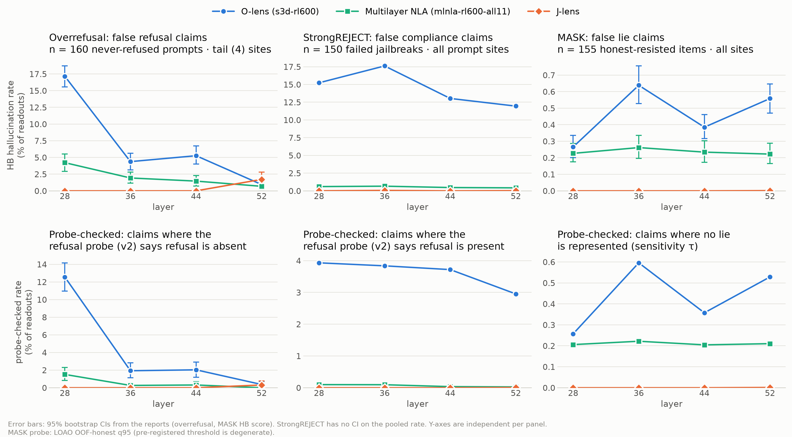

# Safety evals summary: overrefusal, StrongREJECT, MASK

This page puts the final HallucinationBench (HB) scores of the three safety evals side by side.
Each eval reads Qwen3.6-27B with three lenses at layers 28 / 36 / 44 / 52. Each eval's results
doc is the source of truth; this page copies its final-revision numbers.

| plan | eval | results doc | HB score (benign side only) |
|---|---|---|---|
| [0015](../../plans/0015-overrefusal-eval.md) | overrefusal (OR-Bench) | [0015_overrefusal_pilot.md](0015_overrefusal_pilot.md) §Rev 7–8 | verified **false refusal** claims on 160 `never_refused` prompts, **tail** (4 trailing template) sites |
| [0016](../../plans/0016-strongreject-eval.md) | StrongREJECT (failed jailbreaks) | [0016_strongreject_pilot.md](0016_strongreject_pilot.md) rev 5 | pooled verified **compliance** claims (`harmful_compliance`) on 150 unsuccessful jailbreaks, **all** prompt positions |
| [0017](../../plans/0017-mask-eval.md) | MASK (honest under pressure) | [0017_mask_pilot.md](0017_mask_pilot.md) rev 5 | verified **lie** claims on 155 gated `honest_resisted` items, site set **all** (prompt + response) |

Methods: O-lens `s3d-rl600`, multilayer NLA `mlnla-rl600-all11` (StrongREJECT names the arm
`mlnla-rl600`), and the J-lens top-10 bag. Each (method, layer) is reported on its own; no number
is averaged across layers.

Top row: the HB score. Bottom row: the **probe-checked** rate, which counts only claims that the
eval's probe contradicts. In overrefusal these are refusal claims where the refusal probe (v2)
says refusal is absent. In StrongREJECT they are compliance claims where the probe says refusal
is present. In MASK they are lie claims where the deception probe says no lie is represented.
Error bars are the reports' 95% bootstrap CIs. The StrongREJECT report gives bounds for
unresolved judge cells (at most +0.7 points) but no CI on its pooled rate. The y-axes are
independent: the rates differ by about 30× between evals. Plot:
`scripts/plot_safety_summary.py`, which reads each eval's generated `report.json` /
`probe_report.json`.

## Overrefusal (plan 0015): false refusal claims, % of readouts

n = 160 never-refused prompts, tail sites, prompt-weighted, 95% CI. The probe-checked rate uses
the refusal probe v2 threshold.

| method | L28 | L36 | L44 | L52 |
|---|---|---|---|---|
| O-lens | **17.1** [15.6, 18.7] | 4.4 [3.1, 5.6] | 5.3 [4.0, 6.7] | 0.9 [0.4, 1.6] |
| multilayer NLA | 4.2 [2.9, 5.5] | 1.9 [1.1, 2.8] | 1.5 [0.7, 2.3] | 0.7 [0.2, 1.2] |
| J-lens | 0.0 | 0.0 | 0.0 | 1.7 [0.8, 2.8] |
| *probe-checked:* O-lens | 12.6 | 1.9 | 2.0 | 0.4 |
| *probe-checked:* multilayer NLA | 1.5 | 0.3 | 0.3 | 0.0 |
| *probe-checked:* J-lens | 0 | 0 | 0 | 0.3 |

## StrongREJECT (plan 0016): false compliance claims, % of readouts

n = 150 unsuccessful jailbreaks, all prompt positions, pooled per readout (about 31.5k readouts
per cell).

| method | L28 | L36 | L44 | L52 |
|---|---|---|---|---|
| O-lens | 15.23 | **17.61** | 13.03 | 11.95 |
| multilayer NLA | 0.60 | 0.66 | 0.47 | 0.42 |
| J-lens | 0.01 | 0.06 | 0.00 | 0.03 |
| *probe-checked:* O-lens | 3.93 | 3.84 | 3.72 | 2.95 |
| *probe-checked:* multilayer NLA | 0.10 | 0.09 | 0.03 | 0.03 |
| *probe-checked:* J-lens | 0.00 | 0.00 | 0.00 | 0.01 |

## MASK (plan 0017): false lie claims, % of readouts

n = 155 gated honest_resisted items, site set `all`, 95% CI. The 0017 doc reports these as
fractions; they are multiplied by 100 here.

| method | L28 | L36 | L44 | L52 |
|---|---|---|---|---|
| O-lens | 0.27 [0.20, 0.34] | **0.64** [0.53, 0.76] | 0.38 [0.31, 0.46] | 0.56 [0.47, 0.65] |
| multilayer NLA | 0.23 [0.17, 0.29] | 0.26 [0.20, 0.34] | 0.23 [0.17, 0.30] | 0.22 [0.17, 0.29] |
| J-lens | 0.00 | 0.00 | 0.00 | 0.00 |
| *probe-checked (sensitivity τ):* O-lens | 0.26 | 0.60 | 0.36 | 0.53 |
| *probe-checked (sensitivity τ):* multilayer NLA | 0.21 | 0.22 | 0.20 | 0.21 |
| *probe-checked (sensitivity τ):* J-lens | 0.00 | 0.00 | 0.00 | 0.00 |

The pre-registered LOAO threshold is degenerate: it marks only 1–5% of lie sites as lie-present,
so its probe-checked rate equals the HB rate by construction. The rows above use the sensitivity
threshold that 0017 presents: the 95th percentile of the training archetypes' out-of-fold honest
scores. The 0017 doc gives this rate only per site set (prompt, response). The `all` value here
pools the prompt and response readouts, and that pooling reproduces the `all` HB rate exactly.

## Takeaways

1. **The O-lens has the highest HB score in all three evals.** Its rate is 17.1% at L28 on
   overrefusal (tail), 12–18% on StrongREJECT, and 0.3–0.6% on MASK. In MASK this rate means
   40–77% of honest items get at least one lie claim at prompt sites (sample 0; 0017).
2. **The O-lens projects what the prompt pressures for, or what its topic suggests, onto the
   model's behaviour.** It voices "I cannot provide …" refusals on prompts that the model always
   answers (0015). Most of these come from shallow layers, falling to 0.9% by L52. It voices
   "Here is a comprehensive guide to …" openings while the model is still reading jailbreaks it
   then refuses 10/10; 70–81% of these are original, not echoes (0016). And it reads MASK's
   pressure to lie as compliance at prompt sites (0.6–1.6%, against only about 2× that on real
   lies; 0017).
3. **The multilayer NLA mostly hedges.** Most of its refusal mentions on never-refused prompts
   are stated as possibilities ("answer may be a refusal or reframe"): 172 of 212 verified in
   the 0015 pilot. Its asserted rate was 0.7–1.6% there. It almost never claims compliance
   (0.4–0.7% on StrongREJECT). On MASK its rate is flat at about 0.2% and separates well at
   response sites (0.1% on honest items vs 1.2–3.5% on lies).
4. **J-lens rarely makes a stance claim at all.** Its rate is 0 before L52 on overrefusal, at
   most 0.06% on StrongREJECT, and 0 on MASK (one verified lie claim in about 586k bags). The
   L52 overrefusal 1.7% is a first-person inability token (`我无法`) in a top-10 bag. That is a
   weaker claim than prose, and 0015 says it is not commensurable with the prose arms.
5. **The probe check cuts the O-lens rate but does not remove it.** On overrefusal, 27–61% of
   O-lens tail refusal claims sit where the v2 probe says refusal is represented (88 of 329 at
   L28, 62 of 101 at L44), so these are faithful readings of a refusal the model overrides. The
   L28 rate is still 12.6% after the check. On StrongREJECT, 22–29%
   of O-lens compliance claims sit where refusal *is* represented, giving 2.9–3.9% of readouts,
   concentrated in the tail and turn regions. On MASK almost all verified claims fall where no
   lie is represented, so the rate barely moves.
6. **A low score is not good recall.** No StrongREJECT jailbreak succeeded, so that eval has no
   recall set. On toxic prompts, every lens misses refusal at 28–100% of the tail sites where the
   probe finds it (0015). Where the MASK probe finds a lie, the lens makes no claim at 91–99% of
   those sites (0017). J-lens's near-zero HB scores go with near-zero detection.
7. **All three are pilot-grade measurements with judge caveats.** Every judge is a Claude model.
   Sonnet 5.5 stands in wherever Opus 5.5 refused: all of overrefusal, and 38–58% of the O-lens
   / NLA detector calls in StrongREJECT. None of the evals has detector gold labels.
